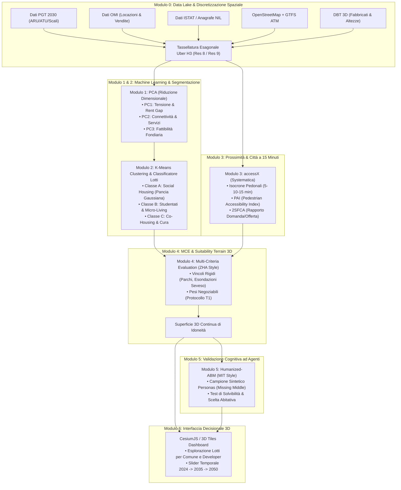

# Orchestratore Fase 1: Digital Planning Hub & Modelli di Idoneità Urbana per Milano
## Mappatura Evidence-Based, Machine Learning e Classificazione dei Lotti per la "Pancia della Gaussiana"

> **Stato del Documento:** Specifiche Tecniche e Architettura di Orchestrazione  
> **Autore:** Dennis Caredda (Tesi Magistrale)  
> **Riferimento Teorico:** Sintesi tra il *Digital Planning Hub* (ZHA / Systematica), i *Modelli Cognitivi ad Agenti* (MIT City Science) e il *Report Fondativo* (Alexander, Pask, De Carlo, MVRDV, Sanchez).  
> **Focus Prioritario:** Identificazione e classificazione dei lotti per soddisfare l'area sottesa alla **pancia della curva gaussiana** (il *Missing Middle*: famiglie a reddito medio, lavoratori, giovani coppie esclusi dal mercato immobiliare libero ma non ammissibili alle case popolari ERP).

---

## 1. Visione di Sistema e Architettura del Flusso Dati

L'Orchestratore della Fase 1 opera come una **pipeline computazionale modulare e riproducibile**. L'obiettivo non è generare una forma architettonica finita (che appartiene alla Fase 2), ma produrre una **piattaforma di evidenza spaziale ed economica** che classifica i lotti disponibili e mappa la *Suitability Terrain* per la governance e i developer.



---

## 2. Modulo 0: Ingestion dei Dati di Milano e Tassellatura Esagonale H3

### 2.1 Fonti Dati e Ingestion Pipeline
I dati grezzi eterogenei vengono acquisiti ed elaborati tramite Python (`GeoPandas`, `Shapely`):

1. **Catasto e Fabbricati 3D**: *Database Topografico (DBT)* del Comune di Milano. Estrazione di ingombri al suolo (*footprint*), volume edificato ($m^3$) e altezza media di gronda.
2. **Pianificazione Urbanistica (PGT 2030)**: *Ambiti di Rigenerazione Urbana (ARU)*, *Ambiti di Trasformazione Urbana (ATU)*, ex Scali Ferroviari (Farini, Romana, Greco, Lambrate, San Cristoforo), lotti dismessi censiti.
3. **Dati di Mercato Immobiliare**: *Osservatorio Mercato Immobiliare (OMI)* dell'Agenzia delle Entrate (semestri 2023-2026). Prezzi medi di vendita al $m^2$ e canoni medi di locazione mensili al $m^2$ per zona OMI.
4. **Dati Demografici e Censuari**: *Dati.Milano.it* e ISTAT per i quartieri (NIL - Nuclei di Identità Locale) e sezioni di censimento: residenti totali, nuclei monogenitoriali, coppie con figli, anziani, residenti stranieri, reddito imponibile medio IRPEF.
5. **Rete di Trasporto e Servizi**: Grafo viario e pedonale da OpenStreetMap + dataset *GTFS di ATM Milano* (linee e fermate M1, M2, M3, M4, M5, tram, bus, nodi del Passante Ferroviario).

### 2.2 Standardizzazione sulla Griglia Esagonale Uber H3
Per evitare il *Modifiable Areal Unit Problem (MAUP)* derivante dai confini amministrativi irregolari, l'intero territorio di Milano viene discretizzato con la libreria Python `h3`:
* **Livello Macro (Analisi di Quartiere)**: Risoluzione H3 livello 8 (area di ogni cella $\approx 0.74\,\text{km}^2$, diametro $\approx 460\,\text{m}$).
* **Livello Micro (Analisi di Lotto e Isolato)**: Risoluzione H3 livello 9 (area $\approx 0.10\,\text{km}^2$, diametro $\approx 170\,\text{m}$).

Ogni cella $h \in \mathcal{H}$ eredita un vettore di stato multi-dimensionale $\vec{F}_h$:
$$\vec{F}_h = \big[ \text{Affitto\_OMI}_h, \, \text{Reddito}_h, \, \text{N\_Famiglie}_h, \, \text{N\_Studenti}_h, \, \text{GFA\_Dismesso}_h, \, \text{Dist\_Metro}_h, \, \text{PAI\_Base}_h \big]$$

---

## 3. Modulo 1: Feature Engineering & PCA per la "Pancia della Gaussiana"

### 3.1 Definizione Matematica delle Feature
Per centrare l'analisi sul *Missing Middle*, vengono calcolate feature specifiche che misurano la frattura tra mercato e bisogni reali:

1. **Rent Gap della Pancia ($\Delta R$)**:
   $$\Delta R_h = \text{Canone\_Mercato\_OMI}_h - \text{Canone\_Sostenibile\_Mediano}$$
   dove il canone sostenibile mediano per Milano è fissato a $85-115\,€/\text{m}^2/\text{anno}$ ($7-9.5\,€/\text{m}^2/\text{mese}$), calcolato come il 30% del reddito mediano netto della famiglia tipo.
2. **Indice di Vulnerabilità all'Espulsione ($V_h$)**:
   $$V_h = \frac{\Delta R_h}{\text{Reddito\_Medio}_h} \cdot \left( \frac{\text{Popolazione\_Famiglie}_h}{\text{Popolazione\_Totale}_h} \right)$$
3. **Indice di Opportunità Fondiaria Trasformabile ($O_h$)**:
   $$O_h = \frac{\text{Area\_Lotti\_Dismessi\_PGT}_h + \text{Area\_Scali}_h}{\text{Area\_Totale}_h}$$

### 3.2 Riduzione Dimensionale con PCA (Principal Component Analysis)
La matrice standardizzata $Z \in \mathbb{R}^{N \times P}$ viene proiettata sugli autovettori della matrice di covarianza $C = \frac{1}{N-1} Z^T Z$:
$$C \vec{v}_k = \lambda_k \vec{v}_k$$
Si selezionano le prime 3 Componenti Principali ($PC_1, PC_2, PC_3$) che spiegano oltre il 75% della varianza totale:
* **$PC_1$ (Pressione del Mercato & Rischio Espulsione Ceto Medio)**: Altissimo carico su Rent Gap e canoni OMI; individua le aree dove il mercato espelle i residenti non abbienti.
* **$PC_2$ (Accessibilità alla Mobilità Veloce & Servizi)**: Carico elevato su prossimità metro/passante e dotazione di servizi primari.
* **$PC_3$ (Capacità Fondiaria di Rigenerazione)**: Carico elevato su disponibilità di lotti dismessi e vuoti urbani del PGT.

---

## 4. Modulo 2: K-Means Clustering & Classificazione Funzionale dei Lotti

### 4.1 Formalizzazione del Clustering
Sui vettori ridotti $\vec{y}_h = [PC_1(h), PC_2(h), PC_3(h)]$, si applica il K-Means clustering minimizzando l'inerzia intra-cluster:
$$\min_{\mathcal{C}} \sum_{k=1}^K \sum_{\vec{y}_i \in \mathcal{C}_k} \|\vec{y}_i - \vec{\mu}_k\|^2$$
Il numero ottimale di cluster ($K=3$) viene validato mediante *Silhouette Analysis* e *Davies-Bouldin Index*.

### 4.2 Tassonomia delle 3 Classi di Lotti Risultanti

| Classe di Lotto | Profilo Funzionale e Sociale | Criteri Spaziali Rilevati | Tipologia Edilizia Consigliata | Esempi Lotti a Milano |
| :--- | :--- | :--- | :--- | :--- |
| **Classe A: Social Housing per la "Pancia della Gaussiana"** | **Famiglie, giovani coppie, lavoratori a reddito medio**. Canoni convenzionati calmierati a lungo termine. | $PC_1$ medio-alto (forte bisogno), $PC_2$ alto (ottima connettività a scuole/metro), $PC_3$ alto (lotto trasformabile). | Tagli alloggio 65–95 $m^2$ (bilocali/trilocali), spazi per l'infanzia, giardini condominiali, verde attrezzato. | Scalo Farini est, Lambrate dismessa, Bovisa-Goccia, Rogoredo, Crescenzago. |
| **Classe B: Studentati & Micro-Living per Giovani Fuorisede** | **Studenti universitari e ricercatori**. Alloggi temporanei a rotazione. | Prossimità immediata (< 15 min a piedi o tram) a poli universitari (PoliMi, UniMi, Bicocca), alta densità di commercio/tempo libero. | Stanze singole con bagno (16–22 $m^2$), cucine e aule studio condivise, lavanderie comuni, bike sharing. | Bovisa Politecnico, Città Studi (aree adiacenti), Bicocca Nord, San Siro M5. |
| **Classe C: Co-Housing Intergenerazionale & Servizi di Quartiere** | **Anziani soli autosufficienti + giovani lavoratori/coppie**. Integrazione sociale e mutuo aiuto. | $PC_2$ medio (servizi sanitari di base vicini), tessuto consolidato di quartiere a bassa intensità viaria. | Alloggi modulari compatti (40–55 $m^2$) attorno a una corte comune, presidio socio-sanitario di quartiere, portierato sociale. | Giambellino-Lorenteggio, Corvetto est, Niguarda, Quarto Cagnino. |

---

## 5. Modulo 3: Analisi di Rete & Accessibilità Pedonale (`accessX` & PAI)

Sulla base delle metodologie di Systematica e Transform Transport, ogni lotto candidato viene sottoposto a verifica di accessibilità attiva su grafo reale OpenStreetMap.

### 5.1 Calcolo delle Isocrone Pedonali con Funzione di Impedenza di Tobler
Il tempo di percorrenza pedonale lungo l'arco stradale $(u, v)$ è funzione della pendenza topografica $\theta$:
$$t_{uv} = \frac{L_{uv}}{6 \cdot \exp\left(-3.5 \cdot |\tan\theta_{uv} + 0.05|\right)} \quad [\text{ore}]$$
Tramite la libreria Python `accessX`, vengono generate le curve isocrone a 5, 10 e 15 minuti attorno a ciascun lotto per:
* Fermate della Metropolitana (M1-M5) e stazioni del Passante Ferroviario.
* Servizi essenziali per la famiglia: asili nido, scuole primarie/secondarie, parchi pubblici, farmacie, presidi sanitari.

### 5.2 Calcolo del Pedestrian Accessibility Index (PAI)
Ad ogni lotto candidato viene assegnato un punteggio $PAI \in \{0, 1, 2, 3, 4, 5\}$:
$$\text{PAI} = \sum_{c=1}^6 w_c \cdot \mathbb{I}\left( t_{\min}(c) \le T_{\text{soglia}}(c) \right)$$
* **PAI 5 (Eccellente)**: Tutti i 6 servizi primari sono raggiungibili entro 10-15 minuti a piedi.
* **PAI $\le 2$ (Insufficiente)**: Il lotto è isolato; non può essere destinato a famiglie della pancia della gaussiana senza un piano contestuale di infrastrutturazione pubblica dei servizi.

---

## 6. Modulo 4: Multi-Criteria Evaluation & Generazione della "Suitability Terrain" 3D (Stile ZHA)

La superficie 3D di idoneità non è statica: **rende espliciti i pesi e i trade-off**, preparando il terreno per la negoziazione multi-attore della Fase 2 (Protocollo T1).

### 6.1 Formulazione Matematica della Idoneità Fondiaria
$$S(x, y) = \left[ w_1 \cdot \text{Classe\_Lotto}(x, y) + w_2 \cdot \text{Rent\_Gap}(x, y) + w_3 \cdot \text{PAI}(x, y) + w_4 \cdot \text{Fattibilità\_PGT}(x, y) \right] \times \prod_{m=1}^M C_m(x, y)$$

#### Vincoli Rigidi Booleani ($C_m = 0$):
* $C_1$: Aree tutelate dal Parco Agricolo Sud Milano e Parchi regionali.
* $C_2$: Fasce di rispetto idraulico (esondazioni Seveso/Lambro con tempo di ritorno < 50 anni non regimentate).
* $C_3$: Vincoli monumentali e paesaggistici assoluti.

#### Vettore dei Pesi Negoziabile ($W = [w_1, w_2, w_3, w_4]$, con $\sum w_k = 1$):
* **Scenario Comune di Milano**: $w_1 = 0.40$ (massimizzazione della pancia della gaussiana), $w_3 = 0.30$ (PAI e città a 15 min).
* **Scenario Developer Sociale**: $w_4 = 0.40$ (fattibilità tecnica ed economica del lotto), $w_1 = 0.30$.
* **Scenario Comitati di Quartiere**: $w_3 = 0.50$ (servizi e verde), $w_2 = 0.30$ (abbattimento canoni).

### 6.2 Output Geometrico: Il Terreno 3D
Il modello produce una mesh tridimensionale continua (in formato GeoTIFF o mesh OBJ/3D Tiles). I picchi altimetrici rappresentano i lotti ottimali in cui costruire Social Housing per il ceto medio produce il massimo rendimento sociale ed ecologico.

---

## 7. Modulo 5: Validazione Cognitiva con Agenti LLM (Stile MIT)

Per testare se i lotti identificati e le volumetrie stimate rispondono ai bisogni reali delle persone prima di deliberare, si attiva il simulatore ad agenti cognitivi.

### 7.1 Campionamento del Campione Sintetico (Personas)
Tramite LLM e libreria `Pydantic`, vengono istanziati 1.000 agenti sintetici rappresentativi del *Missing Middle* milanese:

```python
class MilanesePersona(BaseModel):
    agent_id: str
    target_group: Literal["famiglia_bambini", "giovane_coppia", "lavoratore_singolo"]
    reddito_netto_mensile: float  # es. 1800 - 3200 €
    budget_massimo_canone: float  # max 30-33% del reddito
    requisito_camere: int          # 2 o 3 locali
    luogo_lavoro_principale: str   # es. "Porta Nuova", "Ospedale Niguarda"
    dipendenza_auto: bool          # False per ceto medio urbano
    priorita_servizi: list[str]    # ["asilo", "verde", "metro"]
```

### 7.2 Simulazione della Scelta e Valutazione di Solvibilità
Ciascun agente valuta i lotti proposti dal Modulo 4 attraverso una funzione di scelta discreta arricchita dal ragionamento in linguaggio naturale (CoT - Chain of Thought):
* L'agente risponde:
  1. *Score di Accettabilità (1-10)*.
  2. *Willingness-to-Pay (€/mq)*.
  3. *Perplessità / Punti Critici* (es. *"La fermata della M4 dista 14 minuti: con due passeggini la mattina è troppo lontana senza un percorso protetto"*).
Questo feedback qualitativo viene aggregato e inviato come metrica di raffinamento ai pesi dell'MCE.

---

## 8. Modulo 6: Prototipazione del Digital Twin 3D su CesiumJS

L'interfaccia decisionale finale per il Comune e gli sviluppatori:
1. **Streaming 3D Tiles**: Conversione dei dati catastali volumetrici (DBT Milano) in standard **OGC 3D Tiles** tramite `py3dtiles`.
2. **Visualizzazione Layer**:
   * Mesh 3D della *Suitability Terrain* sovrapposta al tessuto urbano di Milano.
   * Selezione dinamica dei filtri:
     * Toggle: *"Pancia della Gaussiana (Famiglie)"* vs *"Studentati"* vs *"Senior Living"*.
     * Slider del Canone Target: da $80\,€/\text{m}^2/\text{anno}$ a $140\,€/\text{m}^2/\text{anno}$.
     * Slider Temporale: **2024 (Stato di fatto)** $\to$ **2030 (PGT / Scali)** $\to$ **2050 (Visione a lungo termine)**.
3. **Pannello Metriche Real-Time**: Per ogni lotto selezionato (es. Scalo Farini lotto Est), la dashboard visualizza: GFA realizzabile, alloggi generabili per il ceto medio, punteggio PAI, costo stimato del suolo e percentuale di assorbimento della domanda locale.

---

## 9. Piano di Esecuzione Operativo (Cosa Fare Praticamente)

| Step | Azione Operativa | Tool & Librerie | Output Concreto |
| :---: | :--- | :--- | :--- |
| **Step 1** | Download e georeferenziazione dei dataset di Milano (PGT, OMI, ISTAT, OSM). | Python, `geopandas`, `requests` | GeoPackage unificato `milano_data_lake.gpkg` |
| **Step 2** | Partizionamento del territorio di Milano su celle Uber H3 (res 8 e res 9). | `h3-py`, `geopandas` | Griglia H3 georeferenziata con metadati aggregati |
| **Step 3** | Script PCA e K-Means per segmentare le 3 classi di lotti. | `scikit-learn`, `matplotlib` | Report statistico, matrici di carico e mappa cluster |
| **Step 4** | Calcolo isocrone e matrice PAI sui lotti PGT candidati. | `accessX`, `osmnx`, `networkx` | Mappa isocrone e punteggio PAI (0-5) per lotto |
| **Step 5** | Costruzione dell'algoritmo MCE e rendering della Suitability Terrain. | `rasterio`, `numpy`, `scipy` | Raster / Mesh 3D di idoneità fondiaria |
| **Step 6** | Script di simulazione con 1.000 Personas del Missing Middle milanese. | `ollama` (Llama 3 locale) / `pydantic` | Report di assorbimento e criticità qualitative |
| **Step 7** | Esportazione in 3D Tiles e web app interattiva di consultazione. | `py3dtiles`, `CesiumJS` | Web Dashboard 3D dimostrativa per la tesi |
