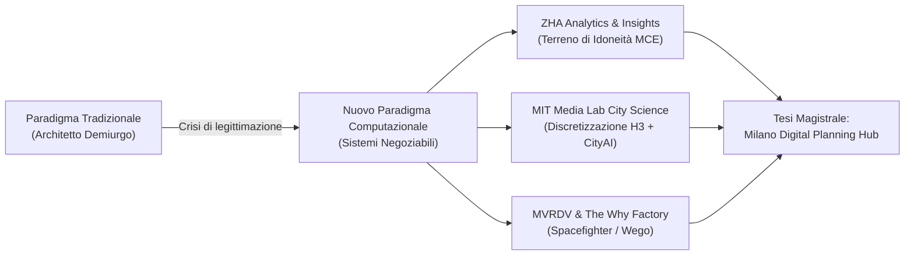
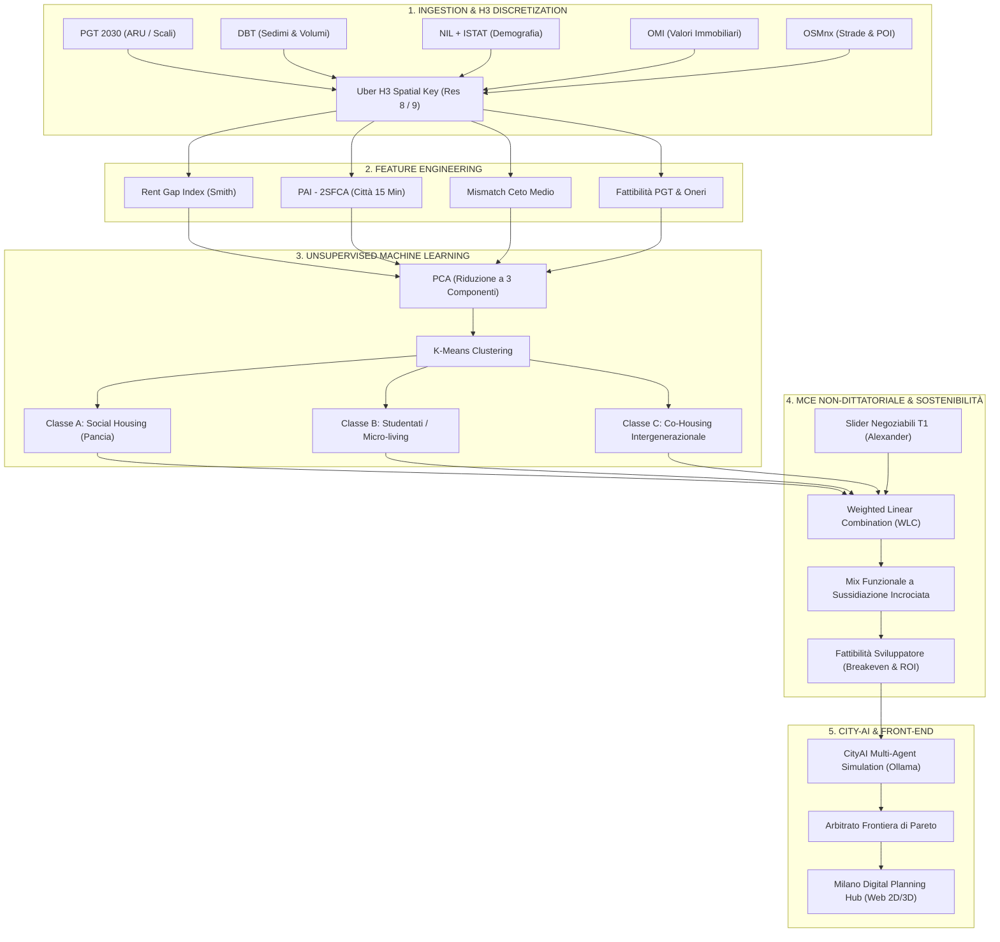

# PIPELINE COMPLETA FASE 1: MILANO 2050 DIGITAL PLANNING HUB
## Evidence-Based Decision Support System & Digital Twin per la Crisi Abitativa a Milano

---

### Indice Generale
1. [Inquadramento Teorico & Progetti di Riferimento](#1-inquadramento-teorico--progetti-di-riferimento)
2. [Obiettivo Fondativo: La "Pancia della Gaussiana" (Missing Middle)](#2-obiettivo-fondativo-la-pancia-della-gaussiana-missing-middle)
3. [Architettura Complessiva della Pipeline (Workflow)](#3-architettura-complessiva-della-pipeline-workflow)
4. [Fasi Operative Dettagliate](#4-fasi-operative-dettagliate)
   - [Step 1: Spatial Discretization & Data Ingestion (H3 Spatial Key)](#step-1-spatial-discretization--data-ingestion-h3-spatial-key)
   - [Step 2: Feature Engineering & Indicatori Urbani](#step-2-feature-engineering--indicatori-urbani)
   - [Step 3: Riduzione Dimensionale & Machine Learning Spaziale (PCA + K-Means)](#step-3-riduzione-dimensionale--machine-learning-spaziale-pca--k-means)
   - [Step 4: Multi-Criteria Evaluation (MCE) Non-Dittatoriale (WLC)](#step-4-multi-criteria-evaluation-mce-non-dittatoriale-wlc)
   - [Step 5: Modellazione Finanziaria & Sussidiazione Incrociata](#step-5-modellazione-finanziaria--sussidiazione-incrociata)
   - [Step 6: Simulazione Multi-Agente LLM & Arbitrato di Pareto (CityAI)](#step-6-simulazione-multi-agente-llm--arbitrato-di-pareto-cityai)
   - [Step 7: Web Digital Twin & 3D Planning Hub Dashboard](#step-7-web-digital-twin--3d-planning-hub-dashboard)
5. [Formulazioni Matematiche Rigorose](#5-formulazioni-matematiche-rigorose)
6. [Architettura AI Locale & Multi-Agente (Zero Costi API)](#6-architettura-ai-locale--multi-agente-zero-costi-api)
7. [Catalogo Ragionato dei Repository GitHub & Librerie Open-Source](#7-catalogo-ragionato-dei-repository-github--librerie-open-source)

---

## 1. Inquadramento Teorico & Progetti di Riferimento

La ricerca si inserisce nella transizione di paradigma da **architetto demiurgo/dittatore di forme** ad **architetto progettista di regole, sistemi e processi di negoziazione democratica**.



### 1.1 Zaha Hadid Architects (ZHA Analytics + Insights) & Systematica
* **Riferimento**: *Benghazi 2050 Digital Planning Hub* (ZHA Code / Instagram `zha.world`).
* **Principi adottati**:
  - Costruzione di un **Suitability Terrain 3D** raster a risoluzione costante che unifica molteplici strati di idoneità territoriale.
  - Valutazione dell'accessibilità pedonale (*PAI - Pedestrian Accessibility Index*) su scala di quartiere attraverso analisi isocrone (5, 10, 15 minuti) su grafo viario (`accessX` di Systematica).
  - Piattaforma web interattiva basata su **Cesium 3D Tiles** per visualizzare simultaneamente i vincoli territoriali, l'estrusione volumetrica del patrimonio edilizio (22.417 edifici) e le metriche di densità occupazionale.
  - Criteri ponderati parametrici in cui ogni slider modifica in tempo reale la visualizzazione e i punteggi dei lotti candidati.

### 1.2 MIT Media Lab City Science (Kent Larson, Taipei Tech Hub)
* **Riferimento**: *CityAI: Autonomous Urban Agents & Cognitive Spatial Simulation* (Video YouTube `vh0OsMmhu60`).
* **Principi adottati**:
  - **Discretizzazione Spaziale Discreta**: Abbandono delle geometrie amministrative eterogenee (NIL, sezioni di censimento ISTAT, microzone OMI) in favore di una griglia poligonale regolare universale basata su **Uber H3** (celle esagonali a Risoluzione 8/9).
  - **Simulazione Comportamentale con LLM (CityAI)**: Agenti autonomi sintetici dotati di profili socio-economici reali che simulano percorsi, preferenze abitative, reazioni alle variazioni di prezzo e disponibilità a pagare (*willingness-to-pay*).
  - **Arbitrato Multi-Stakeholder**: Utilizzo dell'IA come mediatore trasparente per rendere visibile la **Frontiera di Pareto** tra interessi in conflitto (cittadini, sviluppatori immobiliari, amministrazione pubblica).

### 1.3 MVRDV & The Why Factory (Winy Maas)
* **Riferimento**: *Spacefighter (The Evolutionary City Game)*, *Wego (Tailor-Made Housing)*, *OptiMixer*, *City Calculator*.
* **Principi adottati**:
  - L'urbanistica come gioco parametrico a regole esplicite in cui diverse domande di spazio (residenziale, verde, servizi, mobilità) competono per l'allocazione volumetrica.
  - La quantificazione rigorosa del compromesso spaziale: la densità non è un dato a priori ma l'output dell'equilibrio tra risorse e desideri.

### 1.4 Matrice Filosofica e Metodologica della Tesi
* **Giancarlo De Carlo**: *Architettura della Partecipazione* (rifiuto della consultazione a posteriori come mera legittimazione; la partecipazione deve avvenire sulle regole generative del progetto).
* **Christopher Alexander**: *A City is Not a Tree* (la città come semi-reticolo e non come gerarchia ad albero) e *Pattern Language* (sistemi che generano sistemi).
* **Gordon Pask**: *Conversation Theory* (interazione dialogica e ricorsiva tra osservatore, sistema esperto e ambiente).
* **Mario Carpo, Jose Sanchez, Daniel Koehler**: *Discrete Architecture & Mereologia Urbana* (composizione di parti discrete standardizzate capaci di assemblaggi infiniti, superando il formalismo organico del primo parametricismo).

---

## 2. Obiettivo Fondativo: La "Pancia della Gaussiana" (Missing Middle)

Il mercato immobiliare di Milano presenta un fallimento strutturale nella distribuzione dell'offerta abitativa:

$$\text{Offerta Attuale} = \underbrace{\text{Edilizia Residenziale Pubblica (ERP)}}_{\text{Sotto il 1° decile di reddito (ISEE < 16.000 €)}} \quad \cup \quad \underbrace{\text{Mercato Libero & Luxury Asset Class}}_{> 220\ €/\text{m}^2/\text{anno (Oltre l'8° decile)}}$$

Il segmento escluso da qualsiasi risposta politica e di mercato è la **"Pancia della Gaussiana" (il *Missing Middle*)**:
- Famiglie monoparentali o con figli, giovani coppie, infermieri, insegnanti della scuola pubblica, ricercatori, tecnici, operatori del terziario.
- Reddito netto familiare: tra **24.000 € e 45.000 € all'anno** (troppo "ricchi" per le graduatorie popolari ERP, ma sistematicamente espulsi dal mercato libero con prezzi di affitto a Milano > 20 €/mq/mese).
- **Target di Canone Calmierato Sostenibile**: Affitto massimo compreso tra il 25% e il 30% del reddito disponibile:
  $$C_{\text{target}} \approx 7.50 - 8.50\ \text{€}/\text{m}^2/\text{mese} \quad (90 - 100\ \text{€}/\text{m}^2/\text{anno})$$
  *(Un trilocale da 75 m² per una famiglia tipo deve costare tra 560 € e 640 €/mese spese escluse)*.

---

## 3. Architettura Complessiva della Pipeline (Workflow)



---

## 4. Fasi Operative Dettagliate

### Step 1: Spatial Discretization & Data Ingestion (H3 Spatial Key)
1. **La "Stele di Rosetta" Spaziale**: La frammentazione geografica dei dati di Milano (le zone OMI non coincidono con i NIL; i poligoni catastali non coincidono con le sezioni ISTAT) viene superata proiettando tutti gli strati informativi su un unico tessellato esagonale regolare:
   - **Uber H3 Risoluzione 8**: raggio apotema $\sim 460\ \text{m}$, area $\sim 0.737\ \text{km}^2$ (scala di quartiere per analisi macro).
   - **Uber H3 Risoluzione 9**: raggio apotema $\sim 174\ \text{m}$, area $\sim 0.105\ \text{km}^2$ ($\approx 10\ \text{ettari}$, scala ideale per lotti e ambiti di rigenerazione).
2. **I 5 Dataset Ufficiali Target**:
   - `PGT 2030`: Ambiti di Rigenerazione Urbana (ARU), Ambiti di Trasformazione Urbana (ATU), Scali Ferroviari Dismessi (Farini, Romana, Lambrate, Greco, Rogoredo, San Cristoforo, Porta Vittoria).
   - `DBT (Database Topografico Regionale)`: Sedimi fabbricati con altezze di gronda e volumi costruiti.
   - `NIL (88 Nuclei di Identità Locale) & Censimento ISTAT`: Distribuzione per fasce d'età, famiglie mononucleari, reddito medio imponibile IRPEF.
   - `OMI (Osservatorio Mercato Immobiliare - Agenzia delle Entrate)`: Quotazioni minime, medie e massime per compravendita (€/m²) e locazione (€/m²/mese).
   - `OpenStreetMap (OSMnx) & ATM GTFS`: Rete pedonale orientata, stazioni metropolitane (M1-M5), linee S Passante, fermate TPL di superficie, punti di interesse (scuole primarie/secondarie, parchi, presidi sanitari, farmacie, asili).

### Step 2: Feature Engineering & Indicatori Urbani
Per ogni cella esagonale $h_i \in H_3$ e per ciascun lotto candidato, vengono calcolati i seguenti indici vettoriali:
1. **Rent Gap Index ($RG_i$)**: Misura il differenziale tra il valore d'uso attuale capitalizzato e il valore potenziale di mercato derivabile dalla rigenerazione, identificando sia le aree a massimo rischio speculativo sia le aree dove lo scomputo oneri pubblico è più efficace.
2. **PAI (Pedestrian Accessibility Index)**: Calcolato tramite modello **2SFCA (Two-Step Floating Catchment Area)** sulla rete pedonale OSM reale per quantificare la dotazione di servizi essenziali entro 5, 10 e 15 minuti di cammino ($400\ \text{m}$, $800\ \text{m}$, $1.200\ \text{m}$ a $4.5\ \text{km/h}$).
3. **Indice di Pressione sul Ceto Medio ($IPCM_i$)**:
   $$IPCM_i = \frac{\text{Canone Libero OMI}_i - \text{Canone Calmierato Target}}{\text{Reddito Disponibile Famiglie NIL}_i}$$
4. **Indice di Trasformabilità Fondiaria ($ITF_i$)**:
   Rapporto tra superficie fondiaria inedificata/dismessa, vincoli idraulici/paesaggistici (buffer Seveso, Lambro, Parco Sud) e premialità volumetrica prevista dal PGT 2030 per l'Edilizia Residenziale Sociale (ERS).

### Step 3: Riduzione Dimensionale & Machine Learning Spaziale (PCA + K-Means)
1. **PCA (Principal Component Analysis)**:
   - I $\sim 20$ indicatori urbani, spesso collinearmente correlati (es. densità di fermate metro e valore immobiliare), vengono proiettati sulle prime **3 Componenti Principali ($PC_1, PC_2, PC_3$)** catturando $> 80\%$ della varianza:
     - $PC_1$: *Pressione di Mercato & Rent Gap* (vulnerabilità all'espulsione).
     - $PC_2$: *Connettività Rapida & Prossimità ai Servizi* (città a 15 minuti).
     - $PC_3$: *Potenziale di Trasformabilità Fondiaria* (dimensione lotto e scomputo oneri).
2. **K-Means Clustering**:
   - I lotti urbani vengono raggruppati in **3 Classi Funzionali Oggettive**:
     - **CLASSE A: Social Housing per la Pancia della Gaussiana**: Aree a elevata accessibilità pedonale e forte gap abitativo, ideali per famiglie del ceto medio (trilocali/bilocali a canone convenzionato).
     - **CLASSE B: Studentati, Micro-Living & Poli Ricerca**: Aree in prossimità dei campus universitari (Bovisa-PoliMi, Città Studi, MIND-Statale) con elevata densità di trasporto su ferro.
     - **CLASSE C: Co-Housing Intergenerazionale & Servizi di Comunità**: Aree caratterizzate da forte presenza di popolazione anziana, prossimità a parchi urbani, orientate a corti comuni e strutture sociosanitarie integrate.

### Step 4: Multi-Criteria Evaluation (MCE) Non-Dittatoriale (WLC)
- Si applica il metodo **Weighted Linear Combination (WLC)** con vincoli booleani rigidi.
- **Protocollo T1 di Alexander**: I coefficienti di peso non sono imposti algoritmicamente a monte ma sono **parametri mobili esposti all'utente e agli stakeholder**, garantendo la totale verificabilità del modello decisionale.

### Step 5: Modellazione Finanziaria & Sussidiazione Incrociata
Affinché il modello non resti un'utopia teorica, ogni lotto è accompagnato da un bilancio economico parametrico:
- **Sussidiazione Incrociata**:
  - $60\%$ Superficie: Social Housing convenzionato per il ceto medio a canone calmierato ($8\ \text{€}/\text{mq}/\text{mese}$).
  - $15\%$ Superficie: Micro-living/studentati a rotazione veloce.
  - $15\%$ Superficie: Servizi urbani convenzionati (asili nido, spazi studio, laboratori di quartiere).
  - $10\%$ Superficie: Commercio di prossimità, retail e spazi coworking a canone di mercato, che generano il flusso di cassa necessario a coprire i costi di manutenzione e a remunerare il capitale etico.
- **Incentivi Pubblici PGT**: Sconto fino all'80% sul contributo di costruzione e oneri di urbanizzazione primaria e secondaria a fronte dell'impegno trentennale sul canone calmierato.

### Step 6: Simulazione Multi-Agente LLM & Arbitrato di Pareto (CityAI)
- Attivazione di agenti sintetici locali con profili definiti (Cittadino Ceto Medio, Developer Privato, Assessore Comunale).
- Attraverso modelli LLM open-source eseguiti in locale (senza costi API), gli agenti esprimono la propria funzione di utilità.
- L'algoritmo individua l'insieme dei pesi $W^*$ che giace sulla **Frontiera di Pareto**, massimizzando il benessere collettivo senza peggiorare le condizioni minime di fattibilità economica di ciascuna parte.

### Step 7: Web Digital Twin & 3D Planning Hub Dashboard
- Interfaccia grafica ispirata alla visuale scura di ZHA:
  - Canvas 2D planare o 3D isometrico con estrusione volumetrica dei lotti e visualizzazione delle celle H3.
  - Selettore lotti interattivo con centratura dinamica.
  - Inspector a comparsa con scheda dettagliata, metriche di superficie, alloggi realizzabili, composizione del mix e test di sostenibilità economica.
  - Esportatore di dossier urbanistici in formato aperto (JSON/PDF).

---

## 5. Formulazioni Matematiche Rigorose

### 5.1 Indice di Idoneità Territoriale (Weighted Linear Combination)
Per ogni cella spaziale o lotto $i$:

$$S_i = \left( \sum_{j=1}^{n} w_j \cdot f_j(x_{ij}) \right) \cdot \prod_{k=1}^{m} c_{ik}$$

Dove:
- $w_j \in [0, 1]$ è il peso attribuito al criterio $j$, con vincolo $\sum_{j=1}^{n} w_j = 1$.
- $f_j(x_{ij}) \in [0, 1]$ è la funzione di normalizzazione min-max del valore grezzo $x_{ij}$:
  $$f_j(x_{ij}) = \frac{x_{ij} - \min(X_j)}{\max(X_j) - \min(X_j)}$$
- $c_{ik} \in \{0, 1\}$ è la funzione di vincolo booleano rigido:
  $$c_{ik} = \begin{cases} 0 & \text{se il lotto interseca zone di esondazione R4 o parchi regionali inedificabili} \\ 1 & \text{se il lotto è trasformabile} \end{cases}$$

### 5.2 Accessibilità Pedonale 2SFCA (Two-Step Floating Catchment Area)
L'indice di accessibilità del lotto $i$ ai servizi di prossimità $j$ entro la soglia temporale $d_0 = 15\ \text{min}$:

**Step 1**: Per ciascun servizio $j$, calcolo del rapporto fornitura/popolazione servita $R_j$:
$$R_j = \frac{S_j}{\sum_{k \in \{d_{kj} \le d_0\}} P_k \cdot G(d_{kj}, d_0)}$$
Dove $S_j$ è la capacità del servizio (es. posti scuola o mq parco), $P_k$ la popolazione residente nella cella $k$, e $G(d_{kj}, d_0)$ la funzione di decadimento gravitazionale (Gaussian decay).

**Step 2**: Per ogni lotto candidato $i$, somma dei rapporti di fornitura disponibili nel proprio bacino pedonale:
$$PAI_i = \sum_{j \in \{d_{ij} \le d_0\}} R_j \cdot G(d_{ij}, d_0)$$

### 5.3 Funzione Obiettivo K-Means Clustering
Dati $N$ lotti descritti dai vettori ridotti della PCA $\mathbf{z}_i \in \mathbb{R}^3$, partizionarli in $K=3$ cluster $C = \{C_1, C_2, C_3\}$ minimizzando la varianza intra-cluster (inerzia):

$$J(C) = \sum_{k=1}^{K} \sum_{\mathbf{z}_i \in C_k} \|\mathbf{z}_i - \boldsymbol{\mu}_k\|^2$$

Dove $\boldsymbol{\mu}_k = \frac{1}{|C_k|} \sum_{\mathbf{z}_i \in C_k} \mathbf{z}_i$ rappresenta il baricentroide del cluster $k$.

### 5.4 Condizione di Ottimalità della Frontiera di Pareto
Un vettore di pesi decisionali $\mathbf{w}^* = (w_1, w_2, w_3, w_4)$ è **Pareto-ottimale** se e solo se non esiste alcun altro assetto di pesi $\mathbf{w}'$ tale per cui l'utilità di tutti gli stakeholder aumenti o resti invariata e quella di almeno uno migliori strettamente:

$$\nexists \mathbf{w}' \quad \text{tale che} \quad \forall s \in \{\text{Cittadini}, \text{Developer}, \text{Comune}\}, \ U_s(\mathbf{w}') \ge U_s(\mathbf{w}^*) \quad \land \quad \exists s': U_{s'}(\mathbf{w}') > U_{s'}(\mathbf{w}^*)$$

---

## 6. Architettura AI Locale & Multi-Agente (Zero Costi API)

Per garantire l'assoluta riproducibilità scientifica della tesi e l'assenza di costi correnti (niente abbonamenti o chiavi API a pagamento di OpenAI o Anthropic), l'infrastruttura AI viene eseguita **interamente in locale** sulla workstation (Intel i7-11800H, 32 GB RAM, NVIDIA RTX 3050 Ti):

```
                       OLLAMA LOCAL SERVER (localhost:11434)
              Modelli: Llama 3.2 (3B) / Qwen 2.5 (7B-Instruct-Q4_K_M)
                                      │
                                      ▼
                      LANGGRAPH / LANGCHAIN LOCAL ENGINE
                                      │
        ┌─────────────────────────────┼─────────────────────────────┐
        │                             │                             │
        ▼                             ▼                             ▼
  AGENT 1: CITTADINO            AGENT 2: DEVELOPER            AGENT 3: COMUNE
  (Missing Middle)              (Fondo Etico / Costruttore)   (Assessorato Urbanistica)
  • Massimizza: Social Housing  • Massimizza: Densità Slp     • Massimizza: Equità PAI
  • Obiettivo: Affitto < 8€/mq  • Obiettivo: Breakeven Rent   • Obiettivo: 15-Min City
        │                             │                             │
        └─────────────────────────────┼─────────────────────────────┘
                                      │
                                      ▼
                        ARBITRO DI NEGOZIAZIONE (PARETO)
        Ricalibra i pesi W1, W2, W3, W4 e aggiorna il Digital Planning Hub
```

### Schema Prompt per Agenti Locali (Esempio Persona 1)
```python
SYSTEM_PROMPT_CITIZEN = """
Sei il Rappresentante Sintetico della 'Pancia della Gaussiana' per la città di Milano.
Profilo: Famiglia di 3 persone, reddito netto congiunto 32.000 €/anno.
Lavori come insegnante/infermiere.
Il tuo budget massimo sostenibile per l'affitto è di 650 €/mese per un trilocale (massimo 8 €/mq/mese).
Valuta la proposta urbanistica del lotto selezionato (GFA, canone previsto, distanza da metro e scuole).
Esprimi la tua funzione di utilità (0-100) e proponi una variazione sui pesi MCE (W1: Social Housing, W2: PAI, W3: Rent Gap, W4: Fattibilità Fondiaria).
Restituisci esclusivamente un oggetto JSON valido.
"""
```

---

## 7. Catalogo Ragionato dei Repository GitHub & Librerie Open-Source

Tutti gli strumenti selezionati sono open-source con licenze permissive (MIT, Apache 2.0, BSD) e costituiscono lo standard de facto dell'urban computing contemporaneo:

### 7.1 Indicizzazione Spaziale & Discretizzazione Esagonale
| Libreria / Tool | Repository Ufficiale GitHub | Ruolo nella Pipeline di Milano |
| :--- | :--- | :--- |
| **H3 Core** | [uber/h3](https://github.com/uber/h3) | Sistema di indicizzazione gerarchico geospaziale esagonale inventato da Uber. |
| **H3-Python** | [uber/h3-py](https://github.com/uber/h3-py) | Binding Python per convertire geometrie GeoPandas in celle esagonali H3 (Res 8/9). |
| **H3-Pandas** | [DahnJ/h3-pandas](https://github.com/DahnJ/h3-pandas) | Integrazione diretta tra Pandas/GeoPandas e indici esagonali H3. |

### 7.2 Analisi Territoriale, Grafi Stradali & GIS Computazionale
| Libreria / Tool | Repository Ufficiale GitHub | Ruolo nella Pipeline di Milano |
| :--- | :--- | :--- |
| **OSMnx** | [gboeing/osmnx](https://github.com/gboeing/osmnx) | Download e costruzione del grafo stradale e pedonale di Milano da OpenStreetMap; calcolo isocrone. |
| **GeoPandas** | [geopandas/geopandas](https://github.com/geopandas/geopandas) | Manipolazione vettoriale di shapefile, GeoJSON dei NIL, PGT 2030 e particelle catastali. |
| **Shapely** | [shapely/shapely](https://github.com/shapely/shapely) | Operazioni geometriche planari (intersezioni, buffer vincoli fluviali, differenze spaziali). |
| **PySAL** | [pysal/pysal](https://github.com/pysal/pysal) | *Python Spatial Analysis Library*: econometria spaziale, autocorrelazione (Moran's I) e modelli di regressione geografica. |
| **NetworkX** | [networkx/networkx](https://github.com/networkx/networkx) | Analisi topologica di reti e calcolo dei cammini minimi (Dijkstra) per l'indice PAI. |
| **Rasterio** | [rasterio/rasterio](https://github.com/rasterio/rasterio) | Gestione dei raster territoriali (DEM, idrografia, suolo consumato). |

### 7.3 Data Science, Riduzione Dimensionale & Clustering
| Libreria / Tool | Repository Ufficiale GitHub | Ruolo nella Pipeline di Milano |
| :--- | :--- | :--- |
| **Scikit-learn** | [scikit-learn/scikit-learn](https://github.com/scikit-learn/scikit-learn) | Calcolo di `PCA` (riduzione dimensionale) e `KMeans` (classificazione funzionale lotti). |
| **SciPy** | [scipy/scipy](https://github.com/scipy/scipy) | Algoritmi di ottimizzazione convessa, `cKDTree` per ricerche spaziali rapide dei vicini e curve di decadimento. |
| **Pandas** | [pandas-dev/pandas](https://github.com/pandas-dev/pandas) | Elaborazione matriciale di dati ISTAT e OMI. |
| **NumPy** | [numpy/numpy](https://github.com/numpy/numpy) | Operazioni di algebra lineare vettorizzata per matrici di idoneità WLC. |

### 7.4 Motori LLM Locali & Orchestrazione Multi-Agente
| Libreria / Tool | Repository Ufficiale GitHub | Ruolo nella Pipeline di Milano |
| :--- | :--- | :--- |
| **Ollama** | [ollama/ollama](https://github.com/ollama/ollama) | Server di inferenza locale ultra-rapido su GPU NVIDIA; esecuzione di Llama 3.2 e Qwen 2.5 a zero costi. |
| **LangChain** | [langchain-ai/langchain](https://github.com/langchain-ai/langchain) | Framework per la costruzione di catene prompt-modello con output strutturato JSON. |
| **LangGraph** | [langchain-ai/langgraph](https://github.com/langchain-ai/langgraph) | Macchina a stati ciclica per gestire la trattativa e la convergenza tra i 3 agenti sintetici sulla frontiera di Pareto. |
| **Llama 3.2 (Meta)** | [meta-llama/llama-models](https://github.com/meta-llama/llama-models) | Modello di linguaggio leggero (3B parametri) ottimizzato per compiti di ragionamento sintetico ed estrazione dati. |
| **Qwen 2.5 (Alibaba)** | [QwenLM/Qwen2.5](https://github.com/QwenLM/Qwen2.5) | Modello open-weight eccellente per formattazione rigorosa JSON e calcoli quantitativi. |

### 7.5 Digital Twin 3D & Visualizzazione Cartografica Web
| Libreria / Tool | Repository Ufficiale GitHub | Ruolo nella Pipeline di Milano |
| :--- | :--- | :--- |
| **CesiumJS** | [CesiumGS/cesium](https://github.com/CesiumGS/cesium) | Motore per globi 3D e rendering di edifici e terreni in formato *3D Tiles* (come utilizzato da ZHA). |
| **deck.gl** | [visgl/deck.gl](https://github.com/visgl/deck.gl) | Framework WebGL ad altissime prestazioni creato da Uber per visualizzare milioni di esagoni H3 con elevazione 3D. |
| **MapLibre GL JS** | [maplibre/maplibre-gl-js](https://github.com/maplibre/maplibre-gl-js) | Motore cartografico vettoriale open-source per mappe tematiche responsive senza dipendenze commerciali. |
| **Kepler.gl** | [keplergl/kepler.gl](https://github.com/keplergl/kepler.gl) | Tool analitico geospaziale web per esplorazione interattiva multi-layer di grandi dataset urbani. |

---

## 8. Struttura dei File di Progetto Consigliata

```
Desktop/TESI/
├── 05_Urbanistica/
│   ├── PIPELINE_FASE_1_DIGITAL_TWIN_MILANO.md    <-- Questo documento metodologico
│   ├── milano_digital_planning_hub.html           <-- Prototipo interattivo ZHA
│   ├── 00_Metadati/                               <-- Specifica dei 5 dataset Comune di Milano
│   ├── 01_data_ingestion/
│   │   ├── 01_download_milano_opendata.py         <-- Download automatico PGT, NIL, OMI
│   │   └── 02_build_h3_grid.py                    <-- Tassellatura esagonale H3 Res 8/9
│   ├── 02_analytics_and_ml/
│   │   ├── 03_calculate_indicators.py             <-- Rent Gap, PAI 2SFCA, Fabbisogno Pancia
│   │   └── 04_pca_and_kmeans_clustering.py        <-- Riduzione PCA e raggruppamento lotti
│   ├── 03_multi_agent_arbitration/
│   │   └── 05_cityai_ollama_pareto.py             <-- Negoziazione multi-stakeholder
│   └── data_output/
│       ├── milano_h3_res9_features.geojson        <-- Esagoni arricchiti di indicatori
│       └── milano_candidate_lots_classified.json  <-- Schede lotti per il Digital Twin web
```

---
*Documento redatto per Dennis Caredda — Tesi di Laurea Magistrale in Architettura / Ingegneria Edile*  
*Milano 2050: Digital Planning Hub | ZHA & MIT Model Integration*
