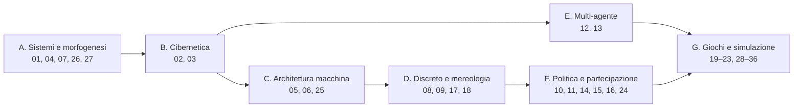
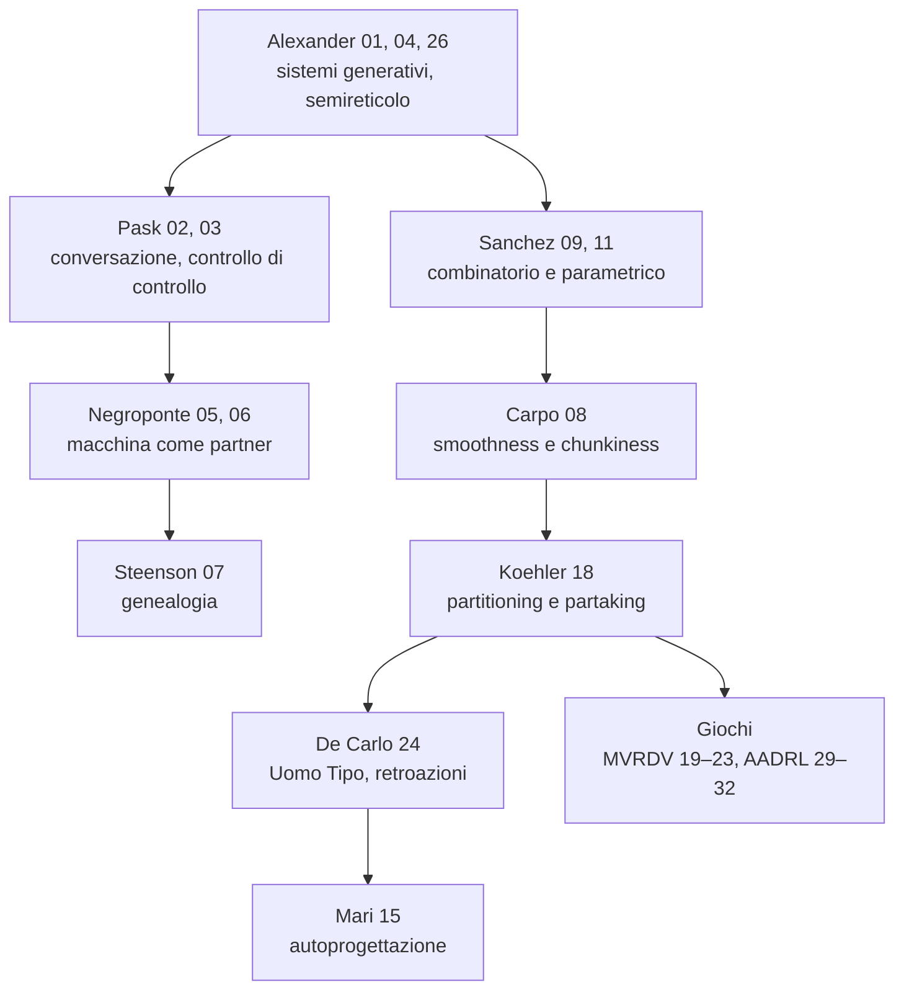
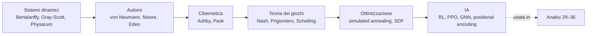

# Mappe

## 1. Sette costellazioni

Le costellazioni sono quelle dell'indice 00 di `03_Analisi Approfondite/`.

## 2. Linea dalla regola alla partecipazione

Il grafo mostra l'ordine con cui le analisi si riferiscono l'una all'altra, come si legge nelle schede.

## 3. Fondamenta matematiche (Atlante, sez. 1–6)

