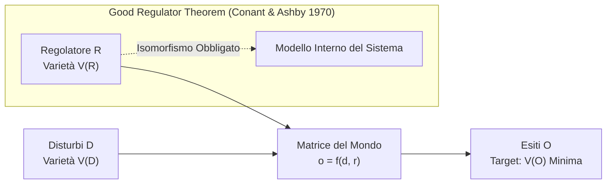
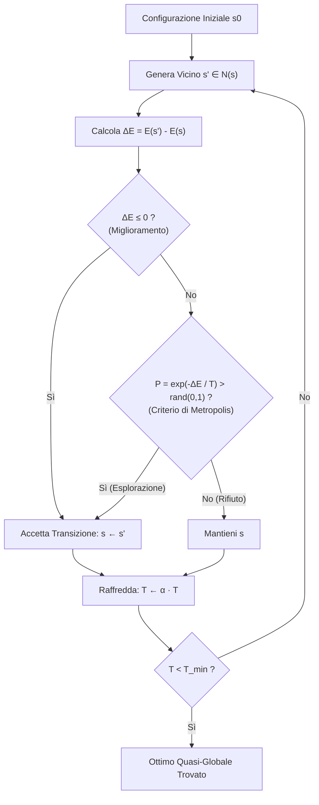
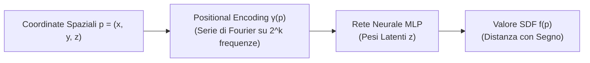

# Atlante Critico dei Modelli Matematici, Filosofici, Cibernetici, di Teoria dei Giochi e di Intelligenza Artificiale

> **Data del documento:** 2026-10-20  
> **Delimitazione metodologica:** In ottemperanza ai criteri di ricerca, la **Statica Grafica 3D** (diagrammi reciproci di forma e forza, maglie poliedriche ed equilibrio di Minkowski) è stata **totalmente esclusa**.  
> Il presente atlante integra e sviluppa analiticamente tutti i modelli del catalogo di progetto, approfondendo ciascuna voce sotto il profilo **matematico analitico**, **filosofico-epistemologico**, **economico-strategico** e **progettuale-computazionale**, corredato da esempi semplici, schemi concettuali e grafici.

---

## Mappa Sinottica dell'Integrazione Concettuale

```mermaid
flowchart TD
    subgraph P1["1. Sistemi Dinamici & Campi"]
        GST["Sistemi Aperti & Flussi (Bertalanffy)"]
        RD["Reazione-Diffusione & Turing (Gray-Scott)"]
        Slime["Biocalcolo di Rete (Physarum)"]
        Fields["Campi Scalari & Paesaggi Energetici"]
    end
    subgraph P2["2. Automi & Computazione Discreta"]
        VN_M["Vicinati di VN & Moore"]
        Replic["Automi Autoreplicanti & Eden (Moore-Myhill)"]
        WFC["Wave Function Collapse & Sintassi"]
        Mereo["Mereologia Formale & Politica (Husserl, Koehler)"]
        UO["Unit Operations & Discreto (Bogost, Carpo)"]
    end
    subgraph P3["3. Cibernetica & Teoria dell'Informazione"]
        Ashby["Varietà Necessaria & Good Regulator"]
        Pask["Conversazione, SAKI & Mutualismo"]
        Alex["Misfit, Semireticoli & Generative Systems"]
        Info["Entropia di Shannon & Markov"]
    end
    subgraph P4["4. Teoria dei Giochi & Spazio"]
        Nash["Minimax, Nash & Strategie Miste"]
        PD["Dilemma del Prigioniero Completo & Collasso"]
        SpatialGames["Teoria dei Giochi Spaziale su Reticolo"]
        Schelling["Micromotivi & Mercati Voxel"]
    end
    subgraph P5["5. Morfogenesi & Spazio delle Soluzioni"]
        Opt["Spazio Combinatorio & Simulated Annealing"]
        SDF["Signed Distance Fields & smin"]
        DiffGeom["Superfici Minime & Rigate"]
        Syntax["Space Syntax, VGA & Voronoi"]
    end
    subgraph P6["6. Intelligenza Artificiale & ML"]
        RL["MDP, Q-Learning & PPO"]
        MARL["Multi-Agent RL & Self-Play"]
        Latent["Autoencoder SDF & Positional Encoding"]
        Graphs["Graph Neural Networks & Diffusori"]
        Vision["VLM, LLM Agenti & Clustering (PCA, K-Means)"]
    end

    P1 <--> P2
    P2 <--> P3
    P3 <--> P4
    P4 <--> P5
    P5 <--> P6
    P6 <--> P1
```



---

## 1. Sistemi Dinamici, Morfogenesi Biologica e Teoria dei Campi

### 1.1 Sistemi Aperti, Stato Stazionario ed Equifinalità (Ludwig von Bertalanffy)

#### Formalizzazione Matematica
Nei sistemi fisici chiusi convenzionali, l'equilibrio corrisponde al massimo dell'entropia termodinamica ($\frac{dS}{dt} \ge 0$) e all'arresto di ogni flusso macroscopico. Un sistema aperto scambia costantemente massa ed energia con l'esterno. Sia $\mathbf{X}(t) \in \mathbb{R}^n$ il vettore di stato (concentrazioni chimiche, biomassa, densità di popolazione, flussi di traffico) e $\mathbf{U}(t) \in \mathbb{R}^m$ il vettore degli input ambientali:
$$\frac{d\mathbf{X}}{dt} = \mathbf{f}(\mathbf{X}, \mathbf{U}, t) = \mathbf{T}(\mathbf{X}, \mathbf{U}) + \mathbf{P}(\mathbf{X})$$
dove $\mathbf{T}$ è la matrice dei flussi di trasporto transfrontalieri e $\mathbf{P}$ è il tasso di produzione/trasformazione endogena.

```
       Flussi Entranti (Materia/Energia/Info)
                  │   T_in
                  ▼
         ┌───────────────────┐
         │   SISTEMA APERTO  │ ──► Processi Interni P(X)
         │  Stato Stazionario│     (Reazioni, Metabolismo)
         └───────────────────┘
                  │   T_out
                  ▼
       Flussi Uscenti (Dissipazione Entropica)
```

* **Stato Stazionario (*Fließgleichgewicht*):** Si verifica quando la variazione netta è nulla pur in presenza di flussi continui:
  $$\frac{d\mathbf{X}^*}{dt} = \mathbf{0} \quad \iff \quad \mathbf{T}(\mathbf{X}^*, \mathbf{U}^*) = -\mathbf{P}(\mathbf{X}^*) \quad (\text{con } \mathbf{T} \ne \mathbf{0}, \mathbf{P} \ne \mathbf{0})$$
* **Equifinalità:** È la proprietà per cui:
  $$\lim_{t \to \infty} \mathbf{X}(t; \mathbf{X}_0^{(1)}) = \lim_{t \to \infty} \mathbf{X}(t; \mathbf{X}_0^{(2)}) = \mathbf{X}^* \quad \forall \, \mathbf{X}_0^{(1)}, \mathbf{X}_0^{(2)} \in \mathcal{D}$$
  Lo stato attrattore finale $\mathbf{X}^*$ è indipendente dalle condizioni iniziali e dipende unicamente dai parametri strutturali del sistema e dai tassi di scambio.
* **Termodinamica del Non-Equilibrio (Ilya Prigogine):** L'evoluzione dell'entropia $S$ in un sistema aperto è:
  $$dS = d_eS + d_iS$$
  dove $d_iS \ge 0$ è la produzione irreversibile interna di entropia e $d_eS$ è il flusso scambiato con l'esterno. Se il sistema esporta entropia verso l'esterno ($d_eS < -d_iS < 0$), l'entropia locale diminuisce ($dS < 0$), generando strutture stabili (**negentropia**).

#### Fondamento Filosofico ed Epistemologico
Rappresenta il superamento definitivo dell'ontologia meccanicistica cartesiana. In architettura e urbanistica, l'edificio o la città non possono essere trattati come sculture geometriche finite (oggetti chiusi all'equilibrio statico), ma come nodi metabolici all'interno di un gradiente termodinamico aperto.

#### Esempio Intuitivo
Una vasca d'acqua con il rubinetto aperto e lo scarico contemporaneamente aperto mantiene un livello perfettamente stabile nel tempo. L'acqua al suo interno non è mai la stessa; la stabilità è una proprietà dinamica dell'attraversamento continuo, non della conservazione statica.

---

### 1.2 Modello di Crescita Asintotica e Allometria Organica

#### Formalizzazione Matematica
La crescita ontogenetica di Bertalanffy (1957) modella il bilancio tra anabolismo (proporzionale alla superficie metabolica, $\propto L^2$) e catabolismo (proporzionale al volume/massa corporea, $\propto L^3$):
$$\frac{dL}{dt} = k(L_\infty - L)$$
Integrando per separazione di variabili con condizione iniziale $L(t_0) = 0$:
$$L(t) = L_\infty \left(1 - e^{-k(t - t_0)}\right)$$
dove $L_\infty$ rappresenta la soglia asintotica massima di scala e $k$ è il tasso catabolico intrinseco.

#### Applicazione Urbana e Computazionale
Nel design generativo parametrico, questa funzione previene l'ipertrofia non controllata delle volumetrie: quando un lotto o un edificio si espande verso la sua capacità di carico infrastrutturale massima ($L_\infty$), il tasso di allocazione decresce esponenzialmente.

---

### 1.3 Sistemi di Reazione-Diffusione (Modello di Gray-Scott)

#### Formalizzazione Matematica
Originato dai fondamenti della morfogenesi chimica di Alan Turing (1952) e parametrizzato da Gray e Scott (1983), il modello descrive l'accoppiamento tra due sostanze chimiche virtuali ($U$ e $V$) su una griglia bidimensionale o tridimensionale:
$$\begin{cases}
\dfrac{\partial u}{\partial t} = D_u \nabla^2 u - uv^2 + F(1 - u) \\
\dfrac{\partial v}{\partial t} = D_v \nabla^2 v + uv^2 - (F + k)v
\end{cases}$$
dove:
* $\nabla^2 = \frac{\partial^2}{\partial x^2} + \frac{\partial^2}{\partial y^2}$ è l'operatore Laplaciano, approssimato su griglia discreta regolare a passo $h$ da:
  $$\nabla^2 u_{i,j} \approx \frac{u_{i+1,j} + u_{i-1,j} + u_{i,j+1} + u_{i,j-1} - 4u_{i,j}}{h^2}$$
* $D_u, D_v$ sono i coefficienti di diffusione ($D_u > D_v$: il precursore diffonde più rapidamente dell'attivatore).
* $uv^2$ è il termine di reazione non lineare (conversione autocatalitica di due molecole di $V$ e una di $U$ in tre molecole di $V$).
* $F$ è il tasso di alimentazione (*feed rate*) che immette nuovo $U$ nel sistema.
* $k$ è il tasso di degradazione (*kill rate*) che rimuove selettivamente $V$.

```
Spazio dei Parametri di Gray-Scott (F, k):
k ▲
  │      [Spotted Patterns / Colonie]
  │           (F ≈ 0.030, k ≈ 0.062)
  │                   *
  │         * [Strisce / Solitoni Labirintici]
  │     (F ≈ 0.040, k ≈ 0.060)
  │
  │   * [Onde a Spirale / Dinamica Caotica]
  │ (F ≈ 0.020, k ≈ 0.050)
  └────────────────────────────────────────► F
```

#### Fondamento Filosofico
La materia non necessita di un demiurgo geometrico esterno: l'instabilità da diffusione (instabilità di Turing) genera l'ordine geometrico (macchie, labirinti, cavità, percorsi) come rottura spontanea di simmetria.

#### Applicazione Progettuale
Nei progetti a fabbricazione robotica (es. Team Robotic, AADRL), i parametri $(F, k)$ non governano reagenti liquidi, ma modulano la densificazione di percorsi materiali o il pattern di deposizione dell'estrusore robotico: aree ad alto transito pedonale ricevono parametri che formano reti continue (strisce), mentre aree a bassa densità si frammentano in isole porose (macchie).

---

### 1.4 Biocalcolo delle Reti: Modello di Physarum polycephalum (Tero et al.)

#### Formalizzazione Matematica
L'ameba policellulare *Physarum polycephalum* risolve il problema di Steiner (alberi di lunghezza minima e reti resilienti) senza possedere un sistema nervoso centrale. Il modello di Tero et al. (2010) definisce una rete a grafo $\mathcal{G} = (\mathcal{V}, \mathcal{E})$:
1. **Flusso nei Condotti (Legge di Poiseuille):** La corrente di biomassa $Q_{ij}$ tra i nodi $i$ e $j$ è generata dal gradiente di pressione idrodinamica $(p_i - p_j)$:
   $$Q_{ij} = \frac{D_{ij}}{L_{ij}} (p_i - p_j)$$
   dove $D_{ij}$ è la conduttanza del tubo e $L_{ij}$ è la sua lunghezza metrica.
2. **Conservazione della Massa (Legge di Kirchhoff ai Nodi):**
   $$\sum_{j \in \mathcal{N}(i)} Q_{ij} = I_i \quad \text{con } \sum_{i} I_i = 0$$
   (dove $I_i > 0$ nei nodi sorgente/cibo e $I_i < 0$ nei nodi assorbitori).
3. **Adattamento Morfologico dei Condotti (Feedback Biologico):**
   $$\frac{dD_{ij}}{dt} = f\left(|Q_{ij}|\right) - \mu D_{ij} = \frac{|Q_{ij}|^\gamma}{1 + |Q_{ij}|^\gamma} - \mu D_{ij}$$
   I rami attraversati da un flusso elevato ispessiscono la propria sezione ($f(|Q|) > \mu D$), mentre i rami ridondanti o a basso flusso subiscono atrofia cellulare ed evaporano ($\mu D$).

---

### 1.5 Campi Scalari, Paesaggi Energetici e Gradienti Fondiari

#### Formalizzazione Matematica
Il suolo d'intervento urbano è modellato come una varietà continua differenziabile su cui agiscono campi scalari di potenziale $V: \mathbb{R}^2 \to \mathbb{R}$.
1. **Campo del Valore del Suolo:**
   $$V(\mathbf{p}) = \sum_{i=1}^m w_i \exp\left(-\frac{\|\mathbf{p} - \mathbf{h}_i\|^2}{2\lambda_i^2}\right)$$
   dove $\mathbf{h}_i$ sono gli hub infrastrutturali, $w_i$ il loro peso gravitazionale e $\lambda_i$ il raggio di decadimento spaziale.
2. **Generazione Morfologica tramite Discesa di Gradiente:** L'orientamento dei lotti, la trama delle facciate o i vettori di allineamento degli edifici seguono le linee di massimo flusso del gradiente o le curve di livello ortogonali:
   $$\mathbf{v}(\mathbf{p}) = \nabla V(\mathbf{p}) = \left(\frac{\partial V}{\partial x}, \frac{\partial V}{\partial y}\right)$$
3. **Paesaggio Energetico Funzionale:** La volumetria ottima è il punto di minimo globale di una funzione costo composita:
   $$E(\mathbf{p}) = - w_L L(\mathbf{p}) - w_Q Q(\mathbf{p}) - w_G G(\mathbf{p}) + w_C C(\mathbf{p})$$
   (massimizzazione di valore fondiario $L$, qualità della vita $Q$, verde $G$, e minimizzazione del costo $C$).

---

## 2. Automi Cellulari, Mereologia e Morfogenesi Discreta

### 2.1 Topologie di Vicinato e Spazio delle Regole Combinatorie

#### Formalizzazione Matematica
Sia un reticolo discreto $\mathcal{L} = \mathbb{Z}^2$. Ciascuna cella $c = (x, y)$ assume uno stato da un alfabeto finito $\Sigma = \{0, 1, \dots, \sigma - 1\}$.  
L'aggiornamento simultaneo globale è regolato da una mappa locale $f: \Sigma^{|\mathcal{N}|} \to \Sigma$.

```
A) Vicinato di Von Neumann (L1)          B) Vicinato di Moore (L∞)
              [ N ]                                [NW] [ N ] [NE]
        [ W ] [ C ] [ E ]                          [ W] [ C ] [ E ]
              [ S ]                                [SW] [ S ] [SE]
   ||Δp||1 = |Δx| + |Δy| ≤ r                  ||Δp||∞ = max(|Δx|, |Δy|) ≤ r
   Cardinalità (r=1): 5 celle                Cardinalità (r=1): 9 celle
```

* **Dimensione dello Spazio delle Configurazioni:**
  Il numero totale di funzioni di transizione deterministiche $f$ calcolabili per un automa con $\sigma$ stati e vicinato a $k$ celle è:
  $$\Omega = \sigma^{\left(\sigma^k\right)}$$
  * Per $\sigma = 2$ stati e vicinato di **von Neumann** ($k = 5$):  
    $$\Omega_{VN} = 2^{2^5} = 2^{32} \approx 4{,}29 \times 10^9 \text{ regole possibili}$$
  * Per $\sigma = 2$ stati e vicinato di **Moore** ($k = 9$):  
    $$\Omega_{M} = 2^{2^9} = 2^{512} \approx 1{,}34 \times 10^{154} \text{ regole possibili}$$
  La transizione dal vicinato di von Neumann a quello di Moore espande lo spazio di ricerca combinatorio di oltre 140 ordini di grandezza.

---

### 2.2 Autoreplicazione, Macchine Universali e Teorema del Giardino dell'Eden

#### L'Automa a 29 Stati di John von Neumann (1966)
Von Neumann dimostrò che la replicazione biologica non richiede vitalismo metafisico ma può essere eseguita da un costruttore universale discreto. La macchina è composta da:
1. Un automa cellulare universale (capace di emulare qualsiasi Macchina di Turing).
2. Un nastro di istruzioni $\Phi(M)$ che codifica la descrizione della macchina stessa.
3. Un braccio costruttore che legge $\Phi(M)$ e sintetizza fisicamente nel reticolo una copia della macchina $M$.
4. Un copiatore di nastro che duplica la descrizione $\Phi(M)$ e la inserisce nella nuova macchina figlia.

*Evoluzioni storiche:*
* **Semplificazione di Codd (1968):** Riduce gli stati da 29 a soli 8 stati sul medesimo vicinato di von Neumann.
* **Loop di Langton (1984):** Dimostra che la computazione universale è una condizione *sufficiente ma non necessaria* per l'auto-riproduzione: un anello di 86 celle con 8 stati si auto-duplica preservando la propria informazione strutturale senza dover contenere una Macchina di Turing completa.

#### Teorema del Giardino dell'Eden (Moore 1962, Myhill 1963)
Sia $\mathcal{C} = \Sigma^{\mathbb{Z}^d}$ l'insieme di tutte le configurazioni globali e $\Phi: \mathcal{C} \to \mathcal{C}$ la mappa globale di transizione indotta dalla regola locale $f$.
* **Configurazione Giardino dell'Eden (*Garden of Eden*):** È una configurazione globale $E \in \mathcal{C}$ che **non possiede predecessori**, ovvero:
  $$\Phi^{-1}(E) = \emptyset$$
  Un Giardino dell'Eden può esistere solo all'inizio del tempo ($t = 0$); non potrà mai essere generato dall'evoluzione autonoma del sistema.
* **Teorema di Moore-Myhill:**
  $$\Phi \text{ è suriettiva su } \mathcal{C} \quad \iff \quad \Phi \text{ è pre-iniettiva su } \mathcal{C}$$
  *(Dove pre-iniettiva significa che due configurazioni che differiscono solo per un numero finito di celle non possono collassare nella medesima configurazione al passo successivo).*  
  Questo teorema fissa il limite termodinamico e computazionale dell'irreversibilità negli automi cellulari.

---

### 2.3 Wave Function Collapse (WFC) e Sintassi Combinatoria

#### Formalizzazione Matematica
Derivato dall'algoritmo di sintesi di texture di Maxim Gumin (2016) e fondato sul problema di soddisfacimento di vincoli (CSP), il **Wave Function Collapse** opera su un reticolo di voxel tridimensionali:
1. **Superposizione Quantistica Virtuale:** A ogni voxel $i$ è associato un insieme di tutti i possibili moduli geometrici ammissibili: $\mathcal{S}_i = \{m_1, m_2, \dots, m_K\}$.
2. **Calcolo dell'Entropia di Shannon:** A ogni iterazione si seleziona il voxel non ancora collassato con la minima entropia:
   $$H(i) = \log\left(\sum_{m \in \mathcal{S}_i} w_m\right) - \frac{1}{\sum_{m \in \mathcal{S}_i} w_m} \sum_{m \in \mathcal{S}_i} w_m \log(w_m)$$
3. **Collasso e Propagazione dei Vincoli:** Si fa collassare il voxel prescelto in un singolo modulo $m^*$ pesato secondo la sua frequenza $w_m$. L'eliminazione degli altri moduli propaga un'onda di restrizioni di adiacenza (tramite matrici di compatibilità lungo i 6 vicini ortogonali) a tutti i voxel circostanti fino al ripristino della consistenza d'arco (algoritmo AC-3).

---

### 2.4 Mereologia: Dalla Fenomenologia di Husserl alla Politica delle Parti

#### Mereologia Formale (Edmund Husserl, *Ricerche Logiche* III; Smith & Mulligan 1983)
A differenza della teoria degli insiemi (dove l'appartenenza $\in$ è astratta e disincarnata), la mereologia studia la relazione concreta **parte-tutto** ($Pxy$: "$x$ è parte di $y$"), definita da tre assiomi:
1. Riflessività: $\forall x, Pxx$
2. Antisimetria: $\forall x, y, (Pxy \land Pyx \implies x = y)$
3. Transitività: $\forall x, y, z, (Pxy \land Pyz \implies Pxz)$

Husserl introduce la nozione cruciale di **Fondazione o Dipendenza Ontologica**:
* **Momento (Parte non-indipendente):** Un'entità $A$ che non può esistere senza un'entità $B$ (es. il colore rispetto alla superficie; la porta rispetto alla parete).
* **Pezzo (Parte indipendente):** Un'entità che può essere isolata e conservare la propria identità formale (es. un mattone, un voxel prefabbricato).

#### Mereologia Politica: *Partitioning vs. Partaking* (Daniel Koehler, 2020)
* **Partitioning (Spazio Continuo del Capitale):** Il blocco monolitico estruso che viene "affettato" dall'alto verso il basso mediante partizioni interne passive. La parte è un sottoprodotto della totalità imposta.
* **Partaking (Spazio Discreto della Cittadinanza):** La forma urbana emerge dall'aggregazione bottom-up di parti discrete indipendenti che scambiano connettività. L'abitante non subisce la suddivisione dello spazio, ma partecipa alla configurazione del tutto attraverso l'assemblaggio dei pezzi.

---

### 2.5 Dal Continuo al Discreto: Unit Operations (Bogost) e Mario Carpo

#### Unit Operations (Ian Bogost, 2006)
In contrasto con le *system operations* (strutture ermeneutiche chiuse e olistiche), Bogost formalizza le **operazioni unitarie**:
* Qualsiasi sistema culturale o computazionale è una composizione dinamica di **unità discrete di significato e comportamento**.
* Il senso non è prefissato in un'icona o in un testo, ma scaturisce dalla **retorica procedurale**: l'argomentazione è codificata nelle regole di esecuzione con cui le unità interagiscono e impongono vincoli all'utente.

#### La Svolta Discreta in Architettura (Mario Carpo, 2023)
Carpo traccia l'arco storico dell'architettura digitale:
1. **Prima Svolta Digitale (Anni '90 - Continuo/Spline):** Dominata dal calcolo infinitesimale e da geometrie fluide prive di interruzioni (NURBS, curve di Bézier).
2. **Seconda Svolta Digitale (Oggi - Discreto/Voxel/Big Data):** La potenza di calcolo non richiede più la sintesi geometrica di una formula continua compressa. Il mondo viene scansionato, calcolato e stampato come un insieme immenso di voxel microscopici finiti e discreti (*chunky architecture*), aggregati secondo regole locali combinatorie.

---

## 3. Cibernetica, Teoria dell'Informazione e Architettura Adattiva

### 3.1 Entropia di Shannon e Catene di Markov

#### Formalizzazione Matematica
Sia una sorgente discreta di eventi spaziali $X$ con probabilità $p(x_i)$:
$$H(X) = - \sum_{i=1}^n p(x_i) \log_2 p(x_i) \quad [\text{bit}]$$
Nelle **Catene di Markov a tempo discreto**, la transizione tra stati spaziali o configurazioni rispetta la proprietà di assenza di memoria:
$$P(X_{t+1} = s_j \mid X_t = s_i, X_{t-1} = s_{i-1}, \dots, X_0 = s_0) = P(X_{t+1} = s_j \mid X_t = s_i) = P_{ij}$$
La distribuzione stazionaria della configurazione $\boldsymbol{\pi}$ converge al vettore proprio sinistro associato all'autovalore $\lambda = 1$ della matrice stocastica $\mathbf{P}$:
$$\boldsymbol{\pi} \mathbf{P} = \boldsymbol{\pi}$$

---

### 3.2 Legge della Varietà Necessaria e Good Regulator Theorem (Ashby & Conant)

#### Risoluzione Filologica delle Fonti (Ashby 1956)
* **La definizione quantitativa di Varietà** come cardinalità e come logaritmo binario ($V = \log_2 |S|$) risiede esattamente in **Capitolo 7, pp. 121–126** (*The Quantity of Variety*).
* **La formulazione della Regolazione come Gioco a Matrice** e l'enunciato analitico della **Legge della Varietà Necessaria** risiedono in **Capitolo 11, Sezioni 11/9–11/11, pp. 202–213**.
* La massima *"Only variety can destroy variety"* compare a p. 207 del testo primario.



#### The Good Regulator Theorem (Roger C. Conant e W. Ross Ashby, 1970)
Dimostrato formalmente su basi insiemistiche ed entropiche nel saggio *Every good regulator of a system must be a model of that system*:
$$\text{Teorema: } \quad \forall \text{ regolatore } \mathcal{R} \text{ che sia ottimale per } \mathcal{S}, \quad \exists \text{ un omomorfismo } h: \mathcal{S} \to \mathcal{R}$$
Un dispositivo non può regolare efficacemente un sistema se non incorpora al proprio interno un modello isomorfo della struttura causale di quel sistema.

---

### 3.3 Gordon Pask: Cibernetica della Conversazione e Macchine Adattive

#### SAKI (Self-Adaptive Keyboard Instructor, 1956)
Macchina didattica adattiva brevettata da Pask: misura costantemente l'errore e il tempo di reazione dell'allievo su una tastiera telescrivente. SAKI calibra la propria varietà interna $V(R)$ per eguagliare la varietà di apprendimento $V(D)$ dell'allievo, mantenendo la prestazione nel punto critico di massimo flusso cognitivo.

#### L'Architettura come Ambiente Mutualistico (Pask, 1969)
Nel saggio *The Architectural Relevance of Cybernetics*, Pask ridefinisce l'architettura:
* L'architetto non progetta una scatola funzionale immobile, ma un **partner di conversazione**.
* L'edificio deve disporre di un'infrastruttura cinetica o computazionale capace di apprendere dai modelli d'uso dell'utente e di modificare le proprie configurazioni (*Fun Palace* di Cedric Price).

---

### 3.4 Christopher Alexander: Dai Misfit ai Semireticoli

#### Decomposizione del Grafo dei Misfit (*Notes on the Synthesis of Form*, 1964)
Il problema progettuale è formalizzato come un grafo $\mathcal{G} = (\mathcal{V}, \mathcal{E})$, dove i vertici $\mathcal{V}$ sono i $N$ requisiti di forma ($x_i \in \{0, 1\}$, con $0 = \text{fit}$, $1 = \text{misfit}$), e gli archi $\mathcal{E}$ sono le interdipendenze fisiche tra requisiti:
$$M(\mathbf{x}) = \sum_{i} c_i x_i + \sum_{(i,j) \in \mathcal{E}} J_{ij} x_i x_j$$
Alexander impiega un algoritmo di partizionamento su base min-cut per decomporre il grafo in sotto-insiemi con **massima coesione interna e minima interazione esterna**.

#### Albero contro Semireticolo (*A City is Not a Tree*, 1965)
* **Albero (Gerarchia Rigida / Modernismo):** Collezione $\mathcal{T}$ tale che presi due insiemi qualsiasi $A, B \in \mathcal{T} \implies A \cap B = \emptyset \lor A \subset B \lor B \subset A$. Nessuna sovrapposizione: zonizzazione funzionale rigida.
* **Semireticolo (Struttura Spontanea / Città Viva):** Collezione $\mathcal{S}$ tale che $\forall A, B \in \mathcal{S} \implies (A \cap B) \in \mathcal{S}$. Gli elementi urbani condividono appartenenze multiple, garantendo ridondanza funzionale e resilienza.

---

## 4. Teoria dei Giochi, il Dilemma del Prigioniero ed Economia Spaziale

### 4.1 Teorema del Minimax ed Equilibrio di Nash

#### Minimax di John von Neumann (1928) per Giochi a Somma Zero
Dati due giocatori con payoff opposti $u_1(x, y) = -u_2(x, y)$:
$$\max_{x \in \Delta_1} \min_{y \in \Delta_2} x^T \mathbf{A} y = \min_{y \in \Delta_2} \max_{x \in \Delta_1} x^T \mathbf{A} y = v^*$$

#### Gioco Non-Cooperativo ed Equilibrio di Nash (1950, 1951)
In un gioco $G = \langle N, (S_i), (u_i) \rangle$ a $N$ giocatori, un profilo $\boldsymbol{\sigma}^* = (\sigma_1^*, \dots, \sigma_N^*)$ è un Equilibrio di Nash se per ogni giocatore $i$:
$$u_i(\sigma_i^*, \boldsymbol{\sigma}_{-i}^*) \ge u_i(\sigma_i, \boldsymbol{\sigma}_{-i}^*) \quad \forall \sigma_i \in \Delta(S_i)$$
Nash dimostra l'esistenza applicando il **Teorema del Punto Fisso di Kakutani** alla corrispondenza di migliore risposta combinata su simplessi compatti e convessi.

---

### 4.2 Il Dilemma del Prigioniero: Trattazione Esaustiva

#### A. La Narrazione Fondativa (Merrill Flood, Melvin Dresher, Albert Tucker, 1950)
Due sospettati (**Giocatore A** e **Giocatore B**) vengono arrestati per un reato grave. La polizia ha prove sufficienti solo per condannarli per un'infrazione minore (1 anno di carcere), ma non per il reato principale (5 anni), a meno che uno dei due non confessi.

I due vengono rinchiusi in celle separate senza possibilità di comunicare. A ciascuno viene fatta la medesima offerta segreta:
1. **Se tradisci il tuo complice (confessi)** e lui tace, tu avrai l'immunità giudiziaria e sarai **liberato subito (0 anni)**, mentre il tuo complice subirà la pena massima (**5 anni**).
2. **Se entrambi tacete (cooperazione reciproca)**, la polizia non può incriminarvi per il reato grave e sconterete solo la pena minore (**1 anno a testa**).
3. **Se entrambi vi accusate a vicenda (defezione reciproca)**, la confessione varrà per entrambi ma con uno sconto: sconterete una pena intermedia (**3 anni a testa**).

#### B. La Matrice dei Payoff (Anni di Carcere vs. Utilità Formale)

| Giocatore A \ Giocatore B | Giocatore B: Coopera (Tace) | Giocatore B: Tradisce (Confessa) |
| :--- | :---: | :---: |
| **Giocatore A: Coopera (Tace)** | **(1 anno, 1 anno)**<br>*Premio per cooperazione* $(R, R)$ | **(5 anni, 0 anni)**<br>*Inganno subito* $(S, T)$ |
| **Giocatore A: Tradisce (Confessa)** | **(0 anni, 5 anni)**<br>*Tentazione del tradimento* $(T, S)$ | **(3 anni, 3 anni)**<br>*Punizione reciproca* $(P, P)$ |

Formalmente in termini di utilità:
* $T$ (*Temptation*): 0 anni di carcere $\to$ Guadagno massimo.
* $R$ (*Reward*): 1 anno di carcere $\to$ Guadagno cooperativo.
* $P$ (*Punishment*): 3 anni di carcere $\to$ Punizione reciproca.
* $S$ (*Sucker's payoff*): 5 anni di carcere $\to$ Peggior esito possibile.

$$T > R > P > S \quad \land \quad 2R > T + S$$

#### C. La Dimostrazione della Strategia Strettamente Dominante
Esaminiamo le scelte del Giocatore A:
* Se B coopera: A ottiene 0 anni tradendo contro 1 anno tacendo $\implies$ Conviene Tradire ($D$).
* Se B tradisce: A ottiene 3 anni tradendo contro 5 anni tacendo $\implies$ Conviene Tradire ($D$).

Qualunque cosa faccia B, per il Giocatore A **tradire produce un risultato strettamente migliore**:
$$u_A(D, s_B) > u_A(C, s_B) \quad \forall s_B \in \{C, D\}$$
Poiché B compie identicamente lo stesso calcolo logico, entrambi scelgono la strategia dominante di tradire:
$$\text{Esito Inevitabile: } (D, D) \implies \text{3 anni di carcere a testa.}$$

#### D. Il Paradosso: Equilibrio di Nash vs. Ottimo Paretiano
* **$(D, D)$ è l'unico Equilibrio di Nash:** Nessun giocatore può migliorare la propria situazione deviando unilateralmente da $D$ (se A decide da solo di cooperare mentre B tradisce, la sua pena sale da 3 a 5 anni). L'equilibrio è una trappola logica stabile.
* **$(D, D)$ NON è Ottimo Paretiano:** L'esito $(C, C)$ (1 anno a testa) è strettamente migliore per entrambi rispetto a $(D, D)$ (3 anni a testa).  
  *La razionalità individuale produce matematicamente un esito collettivamente disastroso.*

#### E. Il Dilemma Ripetuto e i Tornei di Axelrod (1984)
* **Nel gioco a $N$ turni finiti noti:** L'induzione a ritroso (*backward induction*) fa collassare il gioco sul tradimento continuo fin dal turno 1.
* **Nel gioco a orizzonte indefinito con fattore di sconto $\delta \in (0, 1)$:** La cooperazione è un equilibrio stabile se l'ombra del futuro è sufficientemente profonda:
  $$\delta \ge \frac{T - R}{T - P}$$
* **La Strategia Vincente di Anatol Rapoport: Tit for Tat (Occhio per Occhio):**
  1. *Gentile (*Nice*):* Inizia sempre cooperando.
  2. *Reattivo (*Retaliatory*):* Se l'avversario tradisce, tradisci immediatamente al turno successivo.
  3. *Indulgente (*Forgiving*):* Se l'avversario torna a cooperare, dimentica il passato e torna a cooperare subito.
  4. *Trasparente (*Clear*):* Comportamento semplice e prevedibile per favorire la fiducia.

#### F. La Spazializzazione del Dilemma: Nowak & May (1992)
Disponendo agenti su un automa cellulare con **vicinato di Moore o di von Neumann**:
* I cooperatori superstiti si uniscono in **cluster geometrici compatti**. All'interno del cluster, ogni cooperatore è circondato da vicini che cooperano, accumulando punteggi altissimi ($8 \times R$).
* Il fronte compatto resiste e ricaccia indietro i traditori periferici, dimostrando che **la topologia dello spazio fisico salva la cooperazione dall'estinzione**.

---

### 4.3 Thomas Schelling: Micromotivi e Macrocomportamento (1978)

Sia una scacchiera bidimensionale con due popolazioni $\mathbf{A}$ e $\mathbf{B}$.  
Ogni agente è soddisfatto se almeno una quota $\tau$ dei suoi vicini nel vicinato di Moore (8 celle) è della sua stessa tipologia:
$$\frac{\sum_{j \in \mathcal{N}^M(i)} \mathbb{I}(s_j = s_i)}{|\mathcal{N}^M(i)|} \ge \tau$$
Se la condizione è violata, l'agente trasloca nella cella libera più vicina.  
*Risultato:* Anche con una soglia di tolleranza individuale molto aperta ($\tau = 0{,}33$, ovvero basta 1/3 di simili), il sistema converge spontaneamente verso una **segregazione spaziale macroscopica quasi totale**.

---

### 4.4 Negoziazione Multi-Attore e Giochi a Voxel ((w)Ego, SpaceFighter, Oikos)

Nei progetti di aggregazione modulare:
* Ciascun utente massimizza la propria utilità:
  $$U_i(\mathbf{x}) = \sum_k w_{ik} \phi_k(\mathbf{x}) - C_i(\mathbf{x})$$
* **Quattro Motori di Risoluzione delle Collisioni Spaziali ((w)Ego):**
  1. *Blind Engine:* Risoluzione stocastica per precedenza temporale (Satisfaction: 75%).
  2. *Trading Engine:* Mercato di scambio di quote e crediti (Satisfaction: 72%).
  3. *Automaton Engine:* Espansione e ritirata basate su densità locale (Satisfaction: 65%).
  4. *Strategic Engine:* Negoziazione minimax con informazione completa (Satisfaction: 53%).

---

## 5. Ottimizzazione Combinatoria, Geometria Differenziale e Spazio delle Soluzioni

### 5.1 Esplosione Combinatoria dello Spazio di Ricerca a Voxel

Sia una griglia 3D di $N_x \times N_y \times N_z = N_V$ voxel con $K$ programmi funzionali alternativi:
$$\Omega = K^{N_V}$$
Per una volumetria urbana reale di $100 \times 100 \times 5 = 50.000$ voxel con $K = 8$ funzioni:
$$\Omega = 8^{50.000} = (2^3)^{50.000} = 2^{150.000} \approx 10^{45.154}$$
Questo spazio supera di oltre 45.000 ordini di grandezza il numero di atomi nell'universo osservabile ($10^{80}$), rendendo obbligatorio l'uso di algoritmi euristici.

---

### 5.2 Simulated Annealing (Kirkpatrick et al., 1983)



Ispirato al raffreddamento termodinamico dei metalli, accetta transizioni peggiorative con **probabilità di Metropolis**:
$$P(\text{accettazione}) = \exp\left(-\frac{\Delta E}{T_k}\right) \quad \text{con } T_{k+1} = \alpha T_k \quad (0{,}85 \le \alpha < 1)$$
A temperature elevate il sistema esplora l'intero spazio combinatorio; a basse temperature converge verso il minimo globale.

---

### 5.3 Signed Distance Fields (SDF) e Smooth Minimum

Una superficie architettonica $\partial \Omega$ è definita come il luogo degli zeri di una funzione distanza con segno continua $f: \mathbb{R}^3 \to \mathbb{R}$:
$$\partial \Omega = \{\mathbf{p} \in \mathbb{R}^3 \mid f(\mathbf{p}) = 0\} \quad \text{con } \|\nabla f(\mathbf{p})\| = 1$$
Per rendere le operazioni booleane differenziabili e raccordare le geometrie senza spigoli vivi, si impiega la funzione **Smooth Minimum**:
$$\operatorname{smin}_k(a, b) = -k \ln\left(e^{-a/k} + e^{-b/k}\right)$$

---

### 5.4 Morfogenesi Differenziale: Superfici Minime e Superfici Rigate

* **Superfici Minime ($H = 0$):** Superfici a curvatura media identicamente nulla:
  $$H = \frac{\kappa_1 + \kappa_2}{2} = 0 \quad \implies \quad \kappa_1 = -\kappa_2$$
  Ogni punto è un punto di sella con curvatura gaussiana non-positiva ($K = \kappa_1 \kappa_2 \le 0$), garantendo uno stato di pura tensione membranale privo di momenti flettenti.
* **Superfici Rigate (*Ruled Surfaces*):** Generate dalla traslazione continua di un segmento rettilineo nello spazio:
  $$\mathbf{r}(u, v) = (1 - v)\mathbf{a}(u) + v\mathbf{b}(u)$$
  Consentono la fabbricazione industriale di forme a doppia curvatura complessa mediante **taglio robotico a filo caldo rettilineo** (*Oikos*, *AIRS*).

---

### 5.5 Space Syntax e Visual Graph Analysis (VGA)

Formalizzata da Bill Hillier e Julienne Hanson (1984):
1. **Isovist (Campo Visivo Implicito):** $\mathcal{V}(p) = \{q \in \mathcal{D} \mid \overline{pq} \cap \partial \mathcal{D} = \emptyset\}$.
2. **Mean Depth (Profondità Media Topologica):** $MD_i = \frac{1}{N - 1} \sum_{j \ne i} d_{ij}$.
3. **Integrazione Spaziale (Integration Value):** $Int_i = \frac{1}{\text{Relative Asymmetry}(MD_i)}$.  
   I nodi con massima integrazione attraggono spontaneamente transito sociale e commercio naturale.

---

## 6. Intelligenza Artificiale, Reinforcement Learning e Modelli Generativi

### 6.1 Processi Decisionali di Markov (MDP) e Proximal Policy Optimization (PPO)

Un problema di assemblaggio spaziale sequenziale è un MDP definito da $\langle \mathcal{S}, \mathcal{A}, \mathcal{P}, \mathcal{R}, \gamma \rangle$.  
L'algoritmo **PPO (Schulman et al., 2017)** stabilizza l'apprendimento mediante la funzione di loss ritagliata:
$$\mathcal{L}^{\text{CLIP}}(\theta) = \hat{\mathbb{E}}_t \left[ \min\left( r_t(\theta) \hat{A}_t, \, \operatorname{clip}\left(r_t(\theta), 1 - \varepsilon, 1 + \varepsilon\right) \hat{A}_t \right) \right]$$
dove $r_t(\theta) = \frac{\pi_\theta(a_t \mid s_t)}{\pi_{\theta_{\text{old}}}(a_t \mid s_t)}$ e $\hat{A}_t$ è la stima del vantaggio.

---

### 6.2 Positional Encoding (Fourier Features) per Reti Neurali Geometriche



Per superare lo *spectral bias* (la tendenza delle reti neurali ad apprendere solo funzioni a bassa frequenza, smussando gli spigoli architettonici), le coordinate $\mathbf{p} = (x, y, z)$ sono proiettate ad alta frequenza:
$$\gamma(\mathbf{p}) = \left[ \sin(2^0 \pi \mathbf{p}), \cos(2^0 \pi \mathbf{p}), \sin(2^1 \pi \mathbf{p}), \cos(2^1 \pi \mathbf{p}), \dots, \sin(2^{L-1} \pi \mathbf{p}), \cos(2^{L-1} \pi \mathbf{p}) \right]^T$$

---

### 6.3 Graph Neural Networks (GNN) e Diffusione su Topologie

Nei modelli generativi di piante (*Civic Canvas*, *Horizon*):
* L'edificio è un grafo in cui i nodi sono le stanze e gli archi rappresentano adiacenze.
* Un **Graph Autoencoder (GAE)** codifica le matrici di adiacenza e gli attributi:
  $$\mathbf{Z} = \operatorname{GCN}(\mathbf{X}, \mathbf{A}) = \tilde{\mathbf{D}}^{-\frac{1}{2}} \tilde{\mathbf{A}} \tilde{\mathbf{D}}^{-\frac{1}{2}} \mathbf{X} \mathbf{W}$$
* Modelli di diffusione su grafi sintetizzano nuove configurazioni tipologiche prive di collisioni geometriche rimuovendo progressivamente rumore gaussiano.

---

## 7. Quadro Sinottico Generale dei Modelli Analizzati

| Disciplina | Modello Specifico | Formalismo Matematico / Topologico | Principio Filosofico / Funzione di Progetto |
| :--- | :--- | :--- | :--- |
| **Sistemi Dinamici** | **Sistemi Aperti (Bertalanffy)** | $\frac{d\mathbf{X}}{dt} = \mathbf{T} + \mathbf{P}$; $dS = d_eS + d_iS$ | Città come sistema metabolico aperto in stato stazionario. |
| **Sistemi Dinamici** | **Crescita Asintotica** | $\frac{dL}{dt} = k(L_\infty - L) \implies L(t) = L_\infty(1 - e^{-kt})$ | Controllo della saturazione volumetrica urbana. |
| **Morfogenesi** | **Reazione-Diffusione (Gray-Scott)** | $\partial_t u = D_u \nabla^2 u - uv^2 + F(1-u)$; $\nabla^2 u_{i,j}$ discreto | Generazione di percorsi materiali e pattern robotici. |
| **Biocomputazione** | **Physarum (Tero et al.)** | $Q_{ij} = \frac{D_{ij}}{L_{ij}}\Delta p$; $\frac{dD_{ij}}{dt} = f(\|Q\|) - \mu D_{ij}$ | Ottimizzazione organica di reti viarie e infrastrutturali. |
| **Teoria dei Campi** | **Gradienti e Paesaggi Energetici** | $V(\mathbf{p}) = \sum w_i e^{-\frac{d^2}{2\lambda^2}}$; $\mathbf{v} = \nabla V$; $\min E(\mathbf{p})$ | Orientamento di lotti e volumetrie secondo campi fondiari. |
| **Automi Cellulari** | **Vicinato di Von Neumann** | $\mathcal{N}^v_r = \{\|\Delta\mathbf{p}\|_1 \le r\}$; $\|\mathcal{N}^v_1\| = 5$; $\Omega = 2^{32}$ | Propagazione ortogonale su griglia ed assemblaggi discreti. |
| **Automi Cellulari** | **Vicinato di Moore** | $\mathcal{N}^M_r = \{\|\Delta\mathbf{p}\|_\infty \le r\}$; $\|\mathcal{N}^M_1\| = 9$; $\Omega = 2^{512}$ | Regole di crescita 3×3 (Conway Game of Life, Oikos). |
| **Automi Cellulari** | **Teorema Giardino Eden (Moore-Myhill)**| $\Phi^{-1}(E) = \emptyset \iff \Phi \text{ non è pre-iniettiva}$ | Irreversibilità computazionale e stati non generabili. |
| **Sintassi Combinatoria** | **Wave Function Collapse** | $H(i) = -\sum p_m \log p_m$; propagazione AC-3 | Assemblaggio di kit-of-parts modulari senza collisioni. |
| **Filosofia/Ontologia**| **Mereologia (Husserl, Koehler)** | $Pxy \land Pyx \implies x=y$; *Partaking vs Partitioning* | Cittadinanza attiva tramite assemblaggio di parti discrete. |
| **Critica dei Media** | **Unit Operations (Bogost, Carpo)** | Significato = Esecuzione(Regole Locali); svolta discreta | Architettura come aggregazione di voxel algoritmici. |
| **Cibernetica** | **Varietà Necessaria (Ashby)** | $V(O) \ge V(D) - V(R)$; *"Only variety destroys variety"* | Requisito di flessibilità del controllore per l'omeostasi. |
| **Cibernetica** | **Good Regulator (Conant-Ashby)** | $\mathcal{R}_{\text{ottimale}} \implies \exists h: \mathcal{S} \to \mathcal{R} \text{ (omomorfismo)}$ | Necessità per l'edificio smart di modellare l'utente. |
| **Cibernetica** | **Conversazione & SAKI (Pask)** | Adattamento dinamico continuo del tasso di varietà | Architettura interattiva e mutualistica (Fun Palace). |
| **Teoria Urbana** | **Albero vs Semireticolo (Alexander)**| Albero: $A \cap B = \emptyset$; Semireticolo: $(A \cap B) \in \mathcal{S}$ | Progettazione della complessità contro la zonizzazione rigida. |
| **Teoria dei Giochi** | **Equilibrio di Nash & Minimax** | $\max_x \min_y x^T \mathbf{A} y$; $u_i(\sigma_i^*, \boldsymbol{\sigma}_{-i}^*) \ge u_i(\sigma_i, \boldsymbol{\sigma}_{-i}^*)$ | Risoluzione del conflitto d'interesse tra attori urbani. |
| **Teoria dei Giochi** | **Dilemma del Prigioniero Completo** | $T > R > P > S$; $u_i(D, s_{-i}) > u_i(C, s_{-i})$; Tit-for-Tat | Rottura della mano invisibile; cooperazione spaziale. |
| **Teoria dei Giochi** | **Giochi Spaziali & Schelling** | $\frac{\sum \mathbb{I}(s_j = s_i)}{|\mathcal{N}^M|} \ge \tau$; Cluster su reticolo | Emergenza di segregazione spontanea o isole cooperative. |
| **Ottimizzazione** | **Simulated Annealing** | $P(\text{accetto}) = \exp\left(-\frac{\Delta E}{T}\right)$; $T_{k+1} = \alpha T_k$ | Allocazione voxel nei layout evitando ottimi locali. |
| **Geometria** | **Signed Distance Fields (SDF)** | $\partial \Omega = \{f=0\}$; $\operatorname{smin}_k(a,b) = -k\ln(e^{-a/k} + e^{-b/k})$ | Modellazione geometrica continua e differenziabile per AI. |
| **Geometria** | **Superfici Minime e Rigate** | Curvatura media $H = 0$; $\mathbf{r}(u,v) = (1-v)\mathbf{a}(u) + v\mathbf{b}(u)$ | Membrane tensionali e taglio industriale a filo caldo. |
| **Spazio Topologico** | **Space Syntax & VGA** | $Int_i = 1/\text{RA}(MD_i)$; $\mathcal{V}(p) = \text{Isovist}$ | Previsione analitica dei flussi pedonali e della vita sociale. |
| **Intelligenza Artif.** | **Reinforcement Learning (PPO)** | $\mathcal{L}^{\text{CLIP}} = \hat{\mathbb{E}}[\min(r_t \hat{A}_t, \operatorname{clip}(r_t, 1\pm\varepsilon)\hat{A}_t)]$ | Addestramento di agenti costruttori autonomi. |
| **Intelligenza Artif.** | **Positional Encoding (Fourier)** | $\gamma(\mathbf{p}) = [\sin(2^k \pi \mathbf{p}), \cos(2^k \pi \mathbf{p})]$ | Eliminazione dello spectral bias per dettagli geometrici acuti. |
| **Intelligenza Artif.** | **Graph Neural Networks (GAE)** | $\mathbf{Z} = \tilde{\mathbf{D}}^{-\frac{1}{2}} \tilde{\mathbf{A}} \tilde{\mathbf{D}}^{-\frac{1}{2}} \mathbf{X} \mathbf{W}$ | Generazione e compressione di adiacenze tipologiche. |

---

## 8. Testi Fondamentali e Fonti Open Access

* **Ludwig von Bertalanffy**, *General System Theory: Foundations, Development, Applications* (1968).  
  🔗 [Internet Archive - General System Theory](https://archive.org/details/generalsystemthe0000bert_f7s2)
* **Ludwig von Bertalanffy**, *An Outline of General System Theory* (1950).  
  🔗 [PDF Open Access - Institute for the Study of Nature](https://www.isnature.org/Files/Bertalanffy_General_System_Theory.pdf)
* **W. Ross Ashby**, *An Introduction to Cybernetics* (1956).  
  🔗 [PDF Integrale - W. Ross Ashby Digital Archive](http://pcp.vub.ac.be/books/IntroCyb.pdf)
* **John von Neumann**, *Theory of Self-Reproducing Automata* (ed. Arthur W. Burks, 1966).  
  🔗 [PDF - MIT Center for Bits and Atoms (CBA)](https://cba.mit.edu/events/03.11.ASE/docs/VonNeumann.pdf)
* **Edward F. Moore**, *Machine Models of Self-Reproduction* (1962).  
  🔗 [AMS Official Record (DOI: 10.1090/psapm/014/9961)](https://dx.doi.org/10.1090/psapm/014/9961)
* **John von Neumann & Oskar Morgenstern**, *Theory of Games and Economic Behavior* (1944).  
  🔗 [Internet Archive - Theory of Games (DLI Scan)](https://archive.org/details/in.ernet.dli.2015.215284)
* **John F. Nash Jr.**, *Equilibrium Points in N-Person Games*, PNAS (1950).  
  🔗 [PDF Open Access - PNAS](https://www.pnas.org/doi/10.1073/pnas.36.1.48)
* **Robert Axelrod**, *The Evolution of Cooperation* (1984).  
  🔗 [Internet Archive - The Evolution of Cooperation](https://archive.org/details/evolutionofcoope00axel_0)
* **Martin A. Nowak & Robert M. May**, *Evolutionary Games and Spatial Chaos*, *Nature* (1992).  
  🔗 [Nature Record (Spatial Games)](https://www.nature.com/articles/359826a0)
* **Ian Bogost**, *The Rhetoric of Video Games*, in *The Ecology of Games*, MIT Press (2008).  
  🔗 [PDF Open Access - MIT Press Direct](https://direct.mit.edu/books/book-chapter-pdf/227521/9780262260473_c005.pdf)
