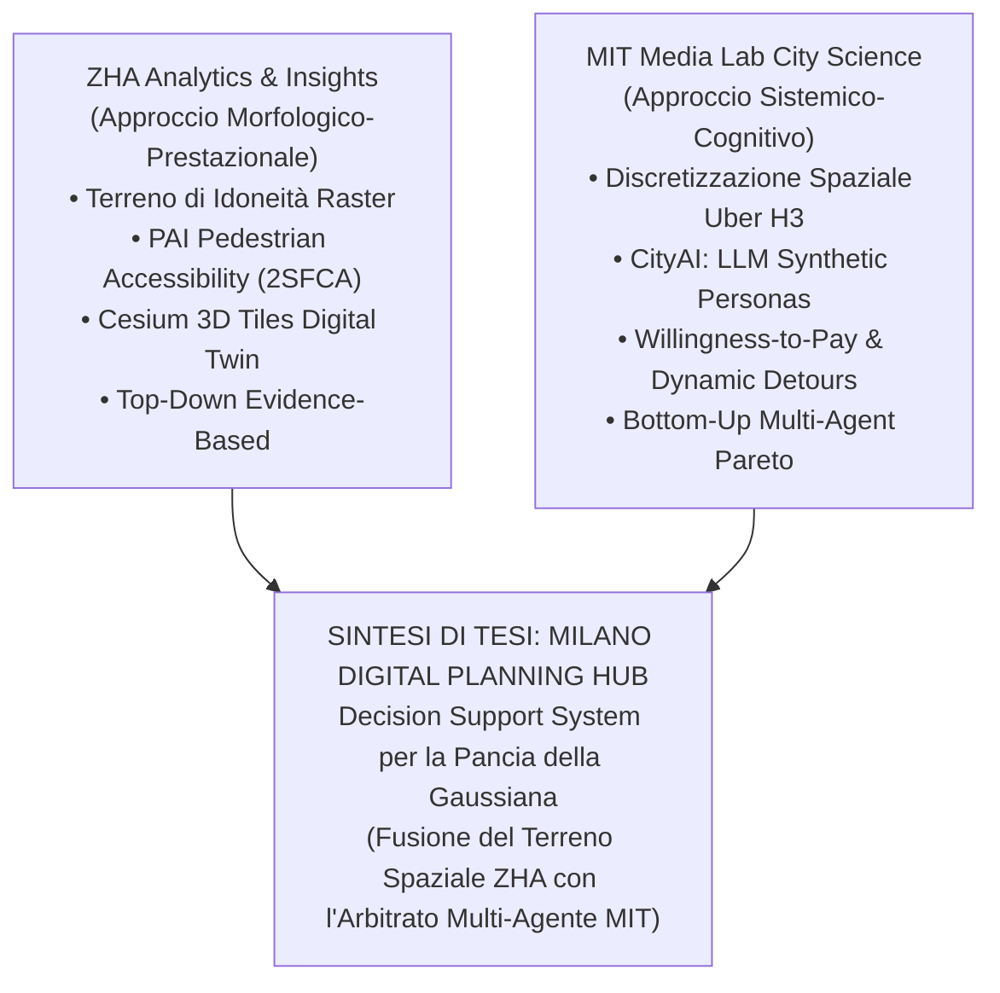

# I MODELLI COMPUTAZIONALI DI ZHA E MIT MEDIA LAB
## Analisi Comparativa, Fondamenti Teorici e Sintesi Operativa per la Tesi di Milano

---

### Indice del Documento
1. [Introduzione: La Convergenza di Due Paradigmi](#1-introduzione-la-convergenza-di-due-paradigmi)
2. [Il Modello ZHA: Analytics & Insights + Systematica (Benghazi 2050)](#2-il-modello-zha-analytics--insights--systematica-benghazi-2050)
   - [2.1 Struttura del Modello e Visione](#21-struttura-del-modello-e-visione)
   - [2.2 Il Suitability Terrain 3D (Sovrapposizione Raster Ponderata)](#22-il-suitability-terrain-3d-sovrapposizione-raster-ponderata)
   - [2.3 Il Pedestrian Accessibility Index (PAI) & Metodologia accessX](#23-il-pedestrian-accessibility-index-pai--metodologia-accessx)
   - [2.4 Il Digital Twin su Cesium 3D Tiles](#24-il-digital-twin-su-cesium-3d-tiles)
   - [2.5 Punti di Forza e Limiti Critici del Modello ZHA](#25-punti-di-forza-e-limiti-critici-del-modello-zha)
3. [Il Modello MIT: Media Lab City Science (Taipei Tech & Kent Larson)](#3-il-modello-mit-media-lab-city-science-taipei-tech--kent-larson)
   - [3.1 Struttura del Modello e Visione Sistemica](#31-struttura-del-modello-e-visione-sistemica)
   - [3.2 La Discretizzazione Spaziale Discreta via Uber H3](#32-la-discretizzazione-spaziale-discreta-via-uber-h3)
   - [3.3 CityAI: La Simulazione Cognitiva con LLM & Agenti Sintetici](#33-cityai-la-simulazione-cognitiva-con-llm--agenti-sintetici)
   - [3.4 Arbitrato Multi-Stakeholder e la Frontiera di Pareto](#34-arbitrato-multi-stakeholder-e-la-frontiera-di-pareto)
   - [3.5 Punti di Forza e Limiti Critici del Modello MIT](#35-punti-di-forza-e-limiti-critici-del-modello-mit)
4. [Matrice Comparativa Analitica: ZHA vs MIT City Science](#4-matrice-comparativa-analitica-zha-vs-mit-city-science)
5. [La Sintesi della Tesi: Unione dei Modelli per la Crisi Abitativa a Milano](#5-la-sintesi-della-tesi-unione-dei-modelli-per-la-crisi-abitativa-a-milano)
   - [5.1 Livello Morfologico-Territoriale (Eredità ZHA)](#51-livello-morfologico-territoriale-eredità-zha)
   - [5.2 Livello Sistemico-Cognitivo (Eredità MIT)](#52-livello-sistemico-cognitivo-eredità-mit)
   - [5.3 Il Contributo Originale della Tesi: La Fattibilità per la "Pancia della Gaussiana"](#53-il-contributo-originale-della-tesi-la-fattibilità-per-la-pancia-della-gaussiana)
6. [Schema Architetturale Integrato per Milano 2050](#6-schema-architetturale-integrato-per-milano-2050)

---

## 1. Introduzione: La Convergenza di Due Paradigmi

La tesi si fonda sull'ibridazione critica di due dei più avanzati modelli di computational urban planning al mondo, ciascuno espressione di un approccio specifico alla complessità della città contemporanea:



* **ZHA Analytics + Insights (con Systematica)** rappresenta l'apice dell'**Urbanismo Computazionale Morfologico-Prestazionale**: affronta la città dal punto di vista dell'evidenza quantitativa, dell'idoneità del suolo, dell'accessibilità pedonale su rete e dell'esplorazione parametrica della forma urbana.
* **MIT Media Lab City Science (Kent Larson)** rappresenta l'apice dell'**Urbanismo Sistemico-Cognitivo**: affronta la città dal punto di vista dell'allocazione discreta dello spazio, del comportamento umano disaggregato, della simulazione soggettiva tramite intelligenza artificiale generativa (LLM) e dell'arbitrato democratico tra interessi divergenti.

---

## 2. Il Modello ZHA: Analytics & Insights + Systematica (Benghazi 2050)

### 2.1 Struttura del Modello e Visione
Il modello sviluppato da **Zaha Hadid Architects Analytics + Insights (ZHAAI)** in collaborazione con la società di ingegneria dei trasporti **Systematica** per il masterplan *Benghazi 2050 Digital Planning Hub* (documentato nel canale ufficiale `zha.world`) nasce per sostituire il masterplan statico bidimensionale con uno **strumento dinamico di supporto alle decisioni (Decision Support System)**.

L'approccio di ZHA si basa su un principio fondativo: **nessuna decisione morfologica viene presa senza un substrato analitico quantitativo multi-criterio**.

### 2.2 Il Suitability Terrain 3D (Sovrapposizione Raster Ponderata)
Il cuore computazionale del modello ZHA è il **Suitability Terrain (Terreno di Idoneità)**. Si tratta di una superficie tridimensionale continua generata attraverso la sovrapposizione algebrica pesata (*Weighted Linear Combination*) di mappe raster a risoluzione costante:

```
[Layer 1: Idoneità Ecologica/Rischio Idraulico]  x W1
                      +
[Layer 2: Accessibilità Infrastrutturale/Transit] x W2
                      +
[Layer 3: Densità Lavorativa & Domanda Sociale]  x W3
                      +
[Layer 4: Aree Dismesse & Potenzialità Fondiaria] x W4
                      x
[Vincoli Booleani Rigidi (Fasce Fiume, Parchi)]
                      =
        SUITABILITY TERRAIN 3D (0.00 -> 1.00)
```

1. **Campionamento Continuo**: Lo spazio metropolitano non è diviso in confini arbitrari ma campionato con una griglia a maglia fine (es. $25 \times 25\ \text{m}$ o $50 \times 50\ \text{m}$).
2. **Normalizzazione Monotona**: Ogni indicatore viene mappato su una scala omogenea $[0, 1]$.
3. **Ponderazione Interattiva**: Tramite slider grafici nella dashboard web, gli urbanisti e gli stakeholder possono modificare i pesi $W_j$. In tempo reale, la mesh tridimensionale si deforma in altezza e cambia colore (da blu/verde ad alto potenziale fino a rosso/viola a basso potenziale), mostrando dove concentrare i nuovi insediamenti.

### 2.3 Il Pedestrian Accessibility Index (PAI) & Metodologia accessX
Sviluppato con Systematica, il PAI misura la qualità della vita urbana secondo il paradigma della **Città a 15 Minuti**:
* **Grafo Viario Reale**: Non utilizza distanze euclidee a "volo d'uccello", ma calcola la distanza reale sulla rete di marciapiedi e percorsi pedonali.
* **Isocrone Multi-Soglia**: Vengono generati bacini isocroni a 5 minuti ($400\ \text{m}$), 10 minuti ($800\ \text{m}$) e 15 minuti ($1.200\ \text{m}$) a una velocità di cammino standard di $4.5\ \text{km/h}$.
* **Formulazione 2SFCA (Two-Step Floating Catchment Area)**:
  L'indice PAI (con punteggio da $0.0$ a $5.0$) pesa non solo la vicinanza, ma il **rapporto tra la capacità dei servizi disponibili** (scuole, farmacie, fermate metropolitane, spazi verdi) e **la popolazione che compete per usufruirne**.

### 2.4 Il Digital Twin su Cesium 3D Tiles
L'output visivo e operativo del modello ZHA è un **Digital Twin 3D distribuito via web**:
* **Piattaforma CesiumJS**: Sfrutta lo standard aperto **OGC 3D Tiles** per renderizzare in streaming web moli enormi di dati tridimensionali.
* **Modellazione Massiva del Costruito**: Nel caso di Bengasi, il viewer gestisce simultaneamente **22.417 edifici estrusi**, colorati parametricamente in base alla funzione, all'epoca di costruzione e allo stato di conservazione.
* **Timeline Multiscalare**: Interruttori temporali (2024 Baseline, 2030, 2050) che consentono di verificare lo stato della città nelle diverse fasi attuative del piano.

### 2.5 Punti di Forza e Limiti Critici del Modello ZHA

| Punti di Forza (ZHA) | Limiti Critici (ZHA) |
| :--- | :--- |
| **Rigore Geometrico e Spaziale**: Precisione millimetrica nella morfologia e nell'infrastruttura. | **Cittadino Ridotto a Statistica**: L'abitante è modellato come densità o pedone passivo a velocità costante ($4.5\ \text{km/h}$). |
| **Visualizzazione 3D Esecutiva**: Standard Cesium 3D Tiles ad altissima fedeltà visiva. | **Assenza di Dinamiche Cognitive**: Non cattura la percezione qualitativa, la paura, il reddito, la disponibilità a pagare (*willingness-to-pay*). |
| **Immediatezza Parametrica**: Gli slider permettono un'esplorazione trasparente dello spazio delle soluzioni. | **Mancanza di Arbitrato Economico**: Non risolve il conflitto d'interessi economico tra costruttori privati, inquilini a basso reddito e finanza pubblica. |

---

## 3. Il Modello MIT: Media Lab City Science (Taipei Tech & Kent Larson)

### 3.1 Struttura del Modello e Visione Sistemica
Il modello del **City Science Group del MIT Media Lab** (guidato da Kent Larson, in collaborazione con il Taipei Tech Hub e documentato nella conferenza *CityAI*) affronta la città non come una composizione di forme architettoniche, ma come un **sistema complesso auto-organizzato basato su flussi, incentivi economici e comportamenti umani decentralizzati**.

### 3.2 La Discretizzazione Spaziale Discreta via Uber H3
Il primo pilastro metodologico del MIT è il superamento totale delle unità amministrative tradizionali:
* **Il Problema dei Confini Tradizionali**: Quartieri, sezioni di censimento e zone catastali hanno forme irregolari, aree disomogenee e cambiano nel tempo, rendendo impossibile la correlazione matematica corretta tra dati diversi.
* **La Soluzione Uber H3 (Tassellatura Esagonale Gerarchica)**:
  - L'esagono è la figura geometrica più efficiente per tassellare il piano: a differenza dei quadrati (che hanno 4 vicini adiacenti e 4 diagonali a distanze diverse), **ogni cella esagonale ha esattamente 6 vicini tutti alla medesima distanza baricentrica**.
  - Assenza di anisotropia direzionale nel calcolo della dispersione e dei cammini pedonali.
  - Multi-risoluzione gerarchica:
    - **H3 Risoluzione 8**: Cella con raggio apotema $\sim 461\ \text{m}$ e area di $\sim 0.737\ \text{km}^2$ (adatta a indicatori a scala di quartiere).
    - **H3 Risoluzione 9**: Cella con raggio apotema $\sim 174\ \text{m}$ e area di $\sim 0.105\ \text{km}^2$ ($\approx 10\ \text{ettari}$, scala del lotto edificabile).
* **Database Spazio-Temporale su H3**: Ogni cella funge da chiave primaria (Primary Key) per unificare dati satellitari, mobilità cellulare, redditi, emissioni e prezzi immobiliari.

### 3.3 CityAI: La Simulazione Cognitiva con LLM & Agenti Sintetici
La vera rottura epistemologica del MIT consiste nell'aver sostituito i modelli di microsimulazione statistica tradizionale con **Agenti Cognitivi dotati di Modelli Linguistici di Grandi Dimensioni (LLM)**:

```
[Persona Sintetica: Famiglia Ceto Medio]
- Reddito: 32.000 €/anno
- Figli: 2 in età scolare
- Priorità: Trilocale < 700€/mese, asilo a 10 min, parco sicuro
                      │
                      ▼ (Inferenza LLM Locale)
           SIMULAZIONE COMPORTAMENTALE
• Scelta Residenziale: Rifiuta lotti con canoni > 9 €/mq/mese
• Dynamic Detour: Devia il percorso pedonale per passare dal parco
• Willingness-to-Pay: Accetta +50€/mese solo se adiacente a stazione metro
```

1. **Generazione di Profili Sintetici**: Gli agenti non sono variabili numeriche anonime, ma "personas" con vincoli di bilancio, abitudini quotidiane e preferenze esplicite.
2. **Dynamic Detours (Deviazioni Dinamiche)**: Gli agenti non scelgono il cammino più breve di Dijkstra; simulano scelte umane realistiche deviando per evitare strade inquinate o prive di marciapiedi, o preferendo percorsi con commercio di prossimità e alberature.
3. **Willingness-to-Pay (WTP)**: L'LLM stima la disponibilità economica reale dell'agente a pagare per l'alloggio in funzione della dotazione di servizi offerta da ciascun lotto.

### 3.4 Arbitrato Multi-Stakeholder e la Frontiera di Pareto
Nel modello MIT, l'algoritmo non decide quale sia il "miglior" progetto urbano (evitando la tecnocrazia dittatoriale). L'architettura CityAI orchestra una **negoziazione multi-agente**:
* Un agente rappresenta i **Cittadini** (massimizza alloggi sociali, spazi verdi e canoni bassi).
* Un agente rappresenta i **Developer Privati** (massimizza la densità edificatoria, il ritorno sul capitale e riduce il rischio normativo).
* Un agente rappresenta la **Governance Pubblica** (massimizza l'equità territoriale, la città a 15 minuti e il gettito per i servizi).
* Il sistema esplora lo spazio delle soluzioni individuando la **Frontiera di Pareto**, ovvero la configurazione di pesi e volumetrie in cui nessun attore può migliorare la propria condizione senza peggiorare quella altrui.

### 3.5 Punti di Forza e Limiti Critici del Modello MIT

| Punti di Forza (MIT) | Limiti Critici (MIT) |
| :--- | :--- |
| **Comprensione Umana e Cognitiva**: Cattura la soggettività, il reddito e le reali preferenze umane. | **Minore Dettaglio Morfologico**: Si ferma spesso alla scala di cella o isolato senza modellare il dettaglio del costruito. |
| **Discretizzazione Perfetta (H3)**: Eliminazione delle distorsioni dei confini amministrativi. | **Costo Computazionale Elevato**: Richiede pipeline di inferenza LLM ben calibrate per evitare allucinazioni. |
| **Democratizzazione della Scelta**: Negoziazione Pareto trasparente invece di scelte arbitrarie. | **Scarsa Integrazione Normativa**: Spesso astrae dai vincoli rigidi dei Piani Regolatori locali (es. PGT di Milano, indici di fabbricabilità fondiaria $I_f$). |

---

## 4. Matrice Comparativa Analitica: ZHA vs MIT City Science

| Dimensione di Confronto | Modello ZHA Analytics + Insights | Modello MIT Media Lab City Science |
| :--- | :--- | :--- |
| **Paradigma Filosofico** | **Morfologico-Prestazionale** (Evidence-based planning) | **Sistemico-Cognitivo** (Agent-based complex systems) |
| **Unità Spaziale Base** | Mappe raster continue + Poligoni vettoriali GIS | Griglia esagonale discreta **Uber H3** (Res 8/9) |
| **Rappresentazione del Cittadino** | Densità statistica aggregata / Flusso pedonale a velocità fissa | **Personas sintetiche qualitative con LLM** (reddito, desideri, WTP) |
| **Analisi di Accessibilità** | **PAI (accessX)**: Isocrone pedonali 5-15 min su grafo con 2SFCA | **Dynamic Detours**: Percorsi scelti per sicurezza, qualità e percezione |
| **Visualizzazione Digital Twin** | **Cesium 3D Tiles**: 22.417 edifici estrusi ad alta fedeltà grafica | Visualizzatori discreti WebGL (**deck.gl**, Kepler.gl, CityScope tangibile) |
| **Motore Decisionale** | **MCE Parametrico**: Pesi ponderati lineari su slider | **CityAI Multi-Agente**: Arbitrato automatico sulla Frontiera di Pareto |
| **Livello di Partecipazione** | Consultazione dell'esito tramite dashboard interattiva | **Negoziazione ricorsiva** tra agenti sintetici rappresentativi |
| **Integrazione con la Finanza** | Stima di massima volumetrica e di densità occupazionale | Funzione di utilità microeconomica e willingness-to-pay |
| **Rapporto con la Governance** | Strumento per grandi masterplan istituzionali top-down | Piattaforma aperta per la democratizzazione della pianificazione |

---

## 5. La Sintesi della Tesi: Unione dei Modelli per la Crisi Abitativa a Milano

La tesi supera la contrapposizione tra ZHA e MIT creando un **Digital Planning Hub integrato a due livelli**, specificamente tarato sulla realtà metropolitana di Milano:

```
┌──────────────────────────────────────────────────────────────────────────────────┐
│                   LIVELLO 1: MORFOLOGICO-TERRITORIALE (ZHA)                      │
│ • Geometrie PGT 2030 (Scali Farini, Bovisa, Lambrate, Rogoredo, Ambiti ARU)     │
│ • Vincoli Rigidi Booleani (Fasce di rispetto fluviale Seveso/Lambro, Parco Sud)  │
│ • Analisi Pedonale PAI 2SFCA (Grafo viario OSMnx + Metro M1-M5 + Passante)       │
│ • Estrusione Volumetrica 3D e rendering viewer (Cesium 3D Tiles ready)           │
└────────────────────────────────────────┬─────────────────────────────────────────┘
                                         │
                                         ▼
┌──────────────────────────────────────────────────────────────────────────────────┐
│                    LIVELLO 2: SISTEMICO-COGNITIVO (MIT)                          │
│ • Discretizzazione Spaziale H3 Res 8/9 (Stele di Rosetta per OMI, NIL, ISTAT)    │
│ • Agenti Sintetici LLM Locali (Zero Costi con Ollama: Llama 3.2 / Qwen 2.5)     │
│ • Funzioni di Utilità e Willingness-to-Pay per la Pancia della Gaussiana         │
│ • Arbitrato sulla Frontiera di Pareto per l'equilibrio dei pesi MCE             │
└────────────────────────────────────────┬─────────────────────────────────────────┘
                                         │
                                         ▼
┌──────────────────────────────────────────────────────────────────────────────────┐
│         CONTRIBUTO ORIGINALE DELLA TESI: FATTIBILITÀ DELLA "PANCIA"              │
│ • Cluster K-Means: Classe A (Social Housing Ceto Medio a canone calmierato)      │
│ • Mix Funzionale a Sussidiazione Incrociata: 60% ERS, 15% Micro, 15% Srv, 10% Com│
│ • Fattibilità Finanziaria PGT: Costo 1450€/mq, Sconto oneri -80%, Breakeven 92€  │
│ • Protocollo T1 di Alexander: Pesi trasparenti e negoziabili (Non-dittatore)     │
└──────────────────────────────────────────────────────────────────────────────────┘
```

### 5.1 Livello Morfologico-Territoriale (Eredità ZHA)
1. **Analisi Spaziale Reale**: Vengono acquisiti i dati ufficiali di Milano (Database Topografico, PGT 2030, rete ATM/Passante) per ricostruire la geometria fisica reale dei lotti trasformabili (ex scali ferroviari ed ex aree industriali).
2. **Accessibilità PAI 2SFCA**: L'accessibilità alla città a 15 minuti viene calcolata scientificamente sulla rete stradale pedonale attraverso `osmnx` e `networkx`.
3. **Cruscotto Visivo ad Alta Fedeltà**: L'interfaccia adotta il tema scuro, i layer attivabili e la visualizzazione 2.5D/3D tipica dei centri di controllo di ZHA.

### 5.2 Livello Sistemico-Cognitivo (Eredità MIT)
1. **Griglia Uber H3 come Stele di Rosetta**: Tutti i dati frammentari di Milano (le zone OMI dell'Agenzia delle Entrate, i NIL del Comune, le sezioni ISTAT, i poligoni catastali) vengono mappati su celle esagonali H3 a Risoluzione 8 e 9, rendendo confrontabili grandezze eterogenee.
2. **CityAI a Costo Zero (Local LLM con Ollama)**:
   - Invece di dipendere da API commerciali a pagamento, l'intelligenza cognitiva gira in locale sulla workstation (modelli `llama3.2:3b` e `qwen2.5:7b`).
   - Gli agenti simulano il comportamento di una **famiglia del ceto medio milanese** (insegnante + impiegato, 2 figli, reddito 32.000 €/anno) verificando se il mix funzionale e il canone proposto consentano un insediamento stabile senza espulsione.

### 5.3 Il Contributo Originale della Tesi: La Fattibilità per la "Pancia della Gaussiana"
Né ZHA né il MIT risolvono il paradosso economico milanese: **chi paga per il canone calmierato se il costo delle aree e della costruzione è insostenibile?**

La tesi risponde introducendo nel modello la **Sussidiazione Incrociata Operativa**:
* Il **$60\%$ della superficie** è vincolato a canone sociale convenzionato ($7.50 - 8.50\ \text{€}/\text{mq}/\text{mese}$) per famiglie del ceto medio.
* Il **$15\%$** è destinato a studentati e micro-living a rotazione veloce.
* Il **$15\%$** è destinato a servizi di quartiere (asili nido, presidi sanitari).
* Il restante **$10\%$ commerciale/terziario** a canone di mercato genera il flusso di cassa necessario a ripagare il debito, mentre il Comune applica lo **scomputo dell'80% sugli oneri di urbanizzazione** previsto dalle norme ERS del PGT di Milano.

---

## 6. Schema Architetturale Integrato per Milano 2050

La sintesi dei due modelli è formalizzata nello schema architetturale del prototipo funzionante [milano_digital_planning_hub.html](file:///C:/Users/Caredda%20Dennis/Desktop/TESI/milano_digital_planning_hub.html):

```
                        MILANO 2050 DIGITAL PLANNING HUB
                               (Architettura Hub)
 ┌─────────────────────────────────────────────────────────────────────────────┐
 │ TOP BAR: Brand ZHA x POLIMI | Focus Pancia della Gaussiana | Timeline 2050  │
 ├───────────────────────────────┬─────────────────────────────┬───────────────┤
 │     PANNELLO SINISTRO         │       MAPPA CENTRALE        │  PANNELLO DX  │
 │   (Input & Pesi Negoziabili)  │    (Canvas 2D / 3D H3)      │  (Inspector)  │
 │                               │                             │               │
 │ • Layer Territoriali PGT      │ • Griglia H3 Esagonale      │ • Scheda      │
 │ • Vincoli Fluviali / Parchi   │ • Gradient Idoneità (ZHA)   │   Lotto #014  │
 │ • Slider MCE Parametrici:     │ • Isocrone accessX 5-15 min │ • Score MCE   │
 │   - W1: Pancia Gaussiana (35%)│ • Linee Metro M1-M5 Colorate│ • PAI 4.4/5.0 │
 │   - W2: Accessibilità PAI(25%)│ • Lotti PGT Cliccabili      │ • Canone:     │
 │   - W3: Rent Gap OMI     (25%)│ • Switch 2D / 3D Isometrico │   8 €/mq/mese │
 │   - W4: Fattibilità PGT  (15%)│ • Pan & Zoom Interattivo    │ • Mix 60/15/  │
 │ • Totale Dinamico: 100%       │                             │   15/10       │
 └───────────────────────────────┴─────────────────────────────┴───────────────┘
                                 │
                                 ▼
 ┌─────────────────────────────────────────────────────────────────────────────┐
 │         FINESTRA MODALE INTERATTIVA: CITY-AI STAKEHOLDER (MIT)              │
 │ • Simula Cittadino (Ceto Medio)   --> Spinge i pesi su W1 (50%) e W2 (30%)  │
 │ • Simula Sviluppatore Immobiliare --> Spinge i pesi su W4 (40%) e W3 (25%)  │
 │ • Simula Assessorato Urbanistica  --> Equilibra su PAI e Città a 15 Minuti  │
 │ • Arbitrato di Pareto Automatico  --> Ricalibra l'assetto ottimo collettivo │
 └─────────────────────────────────────────────────────────────────────────────┘
```

---
*Documento di Ricerca e Sintesi Metodologica — Tesi di Laurea Magistrale di Dennis Caredda*  
*Politecnico di Milano — Architettura / Ingegneria Edile*  
*Riferimenti: ZHA Analytics + Insights (Bengasi 2050) & MIT Media Lab City Science (Taipei Hub)*
